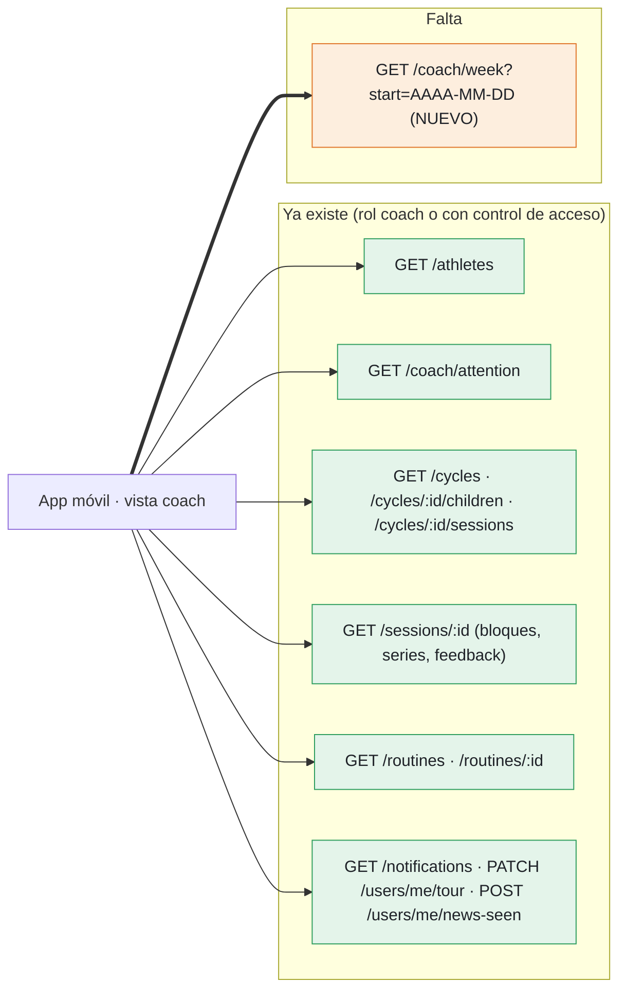
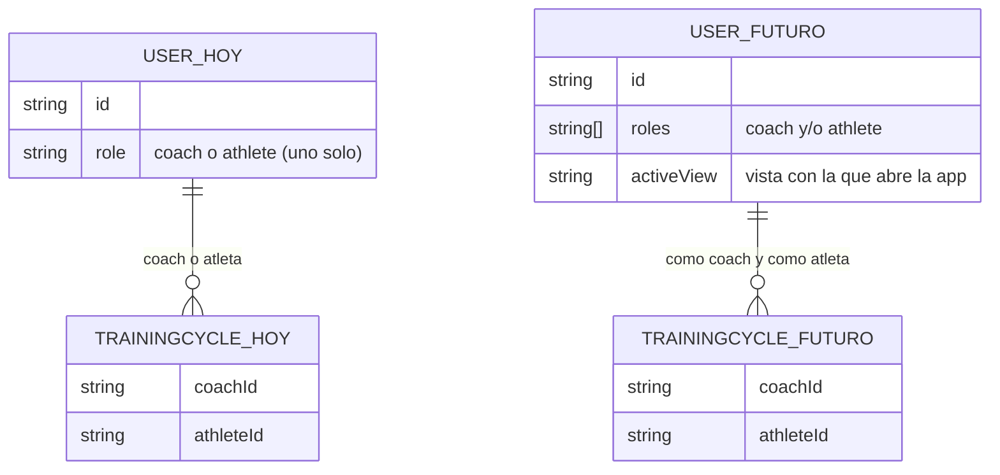

# App móvil con vista de coach (CYC-294)

> Contrastado con `origin/main` (`ccbe7f6`) y con las capturas reales de la app del atleta. Estado: **propuesta, pendiente del «apruebo» de la usuaria**. Sin cambios de código. Maqueta en [`propuestas.html`](propuestas.html), capturas en `capturas/` (iPhone, datos de la base de demostración: coach Camila Reyes y sus ocho atletas; ninguna persona real). Sin pantallas de Resumen.

## Idea de la usuaria

Es **la misma app que usa el atleta, con la vista de coach**: lo importante es **solo ver** las planificaciones, **abrir la sesión que le toca hoy a cada atleta** y tener un **resumen tipo calendario de quienes entrenan esa semana**. El coach sigue creando y editando en la web.

## Lo que hay hoy (verificado)

- La app solo deja entrar a atletas: `AuthContext.startSession` rechaza a quien no tenga `role === 'athlete'` («Esta app es solo para atletas»). Es un bloqueo **del cliente**; la API no lo impone.
- Cuatro pestañas en la isla (Calendario, Inicio, Resumen, Asistente), todas del atleta.
- La API **ya deja leer** al coach lo que esta vista necesita: `GET /cycles`, `/cycles/:id/children`, `/cycles/:id/sessions`, `GET /sessions/:id` (con bloques, ejercicios, series y feedback vigente) y `GET /athletes`, con la regla de relación coach–atleta activa (R5, `assertCycleAccess`).
- La web arma «Esta semana» **desde el cliente**, atleta por atleta (`useCoachRoster` → `boardApi.loadAthleteWeek`: ciclos, ciclos hijos y sesiones de cada uno). Con ~20 atletas son decenas de llamadas: **eso no sirve en un teléfono**.

## Tres formas de ordenar la app

La isla flotante, las perlas, el verde de la fuerza del coach y el azul `#1a66dd` solo para botones y selección son los de CYC-258. Los estados no van solo en color: hecha = check, pendiente = aro, omitida = guion, dolor = punto rojo con leyenda.

| | Pestañas | Primera pantalla | Cuándo conviene |
|---|---|---|---|
| **A (recomendada)** | **Semana · Atletas · Planificaciones** | La semana: matriz de atletas × días, «Necesitan atención» y la lista de hoy. | Lo que pidió la usuaria, en ese orden, y la isla conserva tres botones como en la app del atleta. |
| **B** | Semana · Planificaciones | La semana; al atleta se llega desde su nombre. | La más simple; pierde un lugar natural para «Atención» y el listado. |
| **C** | Hoy · Semana · Planificaciones | «Hoy»: cuántas sesiones van y quién entrena. | Si lo más urgente del coach fuera el día y no la semana; duplica información con Semana. |

**Por qué A:** el coach hace tres preguntas distintas, cada una con su pestaña: *¿quién entrena esta semana?* (Semana), *¿cómo está cada atleta?* (Atletas, con «Necesitan atención» arriba) y *¿qué planifiqué?* (Planificaciones). La sesión del día se abre desde la matriz o desde la ficha del atleta.

**Cómo se entra:** el inicio de sesión **detecta el rol** y muestra la vista que corresponde; no hay selector. Quien no tenga rol todavía completa su perfil en la web (hoy así funciona).

## Pantallas (opción A)

1. **Semana.** Encabezado «Semana» con campana y avatar. Fila «Necesitan atención» con contador (lleva a Atletas). Tarjeta «Esta semana, 16 al 22 nov» con la matriz: una fila por atleta, una columna por día, la de hoy resaltada. Debajo, «Hoy, miércoles 18» con quién entrena y su estado. Tocar una perla abre **esa sesión de ese atleta**; tocar el nombre abre su ficha.
2. **Atletas.** «Necesitan atención» (qué pasó, en una línea) y «Todos tus atletas» con su ciclo y el estado de hoy.
3. **Ficha del atleta.** La tarjeta oscura del ciclo (como la del atleta), la sesión de hoy con **Ver la sesión** y la lista de la semana.
4. **Sesión del día.** Como la ve el atleta (bloques por color, ejercicios y series), con su estado: **En curso** o **Con feedback**. El feedback muestra esfuerzo y un indicador de dolor.
5. **Planificaciones.** Selector Ciclos | Rutinas; en Ciclos, la lista; el detalle muestra las semanas (S1 a S6), las sesiones y sus bloques, **solo lectura**.
6. **Estados vacíos.** Sin atletas («Invítalos desde la web»), semana sin sesiones («Ver la semana actual») y sin planificaciones. La acción es **«Copiar enlace de la web»**: no edita nada, solo lleva al coach a donde sí puede.
7. **Novedad** `coach-mobile@1` (ver abajo).

Con ~20 atletas la matriz mide unos 920 px: se desplaza hacia abajo con los días fijos arriba; los atletas con aviso van primero y el resto por nombre.

## Las cuatro decisiones (con recomendación)

| Decisión | Recomendación | Por qué |
|---|---|---|
| **¿Solo ver o acciones rápidas?** | **Solo ver en esta versión.** | Todo lo que escribe sigue yendo por la web: no se suman permisos de escritura ni qué hacer si el coach toca por error. Notas rápidas o ajustes pueden ser una tarjeta propia después. |
| **¿Se ve el feedback, el dolor y los datos sensibles?** | **Sí al estado y al esfuerzo; el dolor llega como indicador y la nota queda plegada tras «Ver nota».** | El coach ya los ve en la web y el atleta acepta que «el coach verá las notas de dolor» (política de privacidad). Pero un teléfono se mira en público: por defecto no se lee la nota completa. Las notificaciones **nunca** llevan datos de salud (R7). |
| **¿Coach y atleta a la vez?** | **No en esta versión: una cuenta, un rol.** La app muestra la vista según el rol de la cuenta. | La base tiene **un solo `role` por usuario**; permitir los dos pide cambiar el modelo (diagrama más abajo). Quien sea ambos puede usar dos cuentas por ahora. |
| **Pantalla Atención de la web** | **Sí, solo lectura:** contador en Semana y bloque «Necesitan atención» al inicio de Atletas. «Aplicar ajuste de carga» **se queda en la web**. | Es lo primero que un coach quiere saber en el teléfono, y no hace falta endpoint nuevo: sirve `GET /coach/attention`. |

## Qué falta en la API (para las tarjetas de Organización)

| # | Qué | Tipo | Detalle |
|---|---|---|---|
| 1 | **`GET /coach/week?start=AAAA-MM-DD`** | **API (nuevo, rol coach)** | Una sola llamada: los atletas activos del coach y, de cada uno, el ciclo activo (nombre, semana n de N) y sus sesiones de la semana: `id`, `name`, `dayIso`, `status` (`pending`, `done`, `skipped`) y `hasPain` (**solo un booleano**: la nota va en `GET /sessions/:id`). Reemplaza el recorrido por atleta de la web. Mismo control de acceso R5; sin datos de salud en el listado. |
| 2 | Sacar el bloqueo de rol en la app | **App móvil** | `AuthContext.startSession` deja entrar a `role === 'coach'`; `RootNavigator` elige entre las pestañas del atleta y las del coach. No toca la API. |
| 3 | Pestañas, pantallas y estados vacíos del coach | **App móvil** | Semana, Atletas, Planificaciones, ficha, sesión de solo lectura y detalle de ciclo; reutiliza `SessionDetailScreen` y las tarjetas del atleta. «Copiar enlace de la web» no necesita API. |
| 4 | Ficha de novedad `coach-mobile@1` | **App móvil + `packages/shared`** | `roles: ["coach"]`, `platforms: ["mobile"]` (ya es posible en `NoveltyRole` / `NoveltyPlatform`). Hoy `NOVELTY_VIEWER` está fijo en atleta: debe salir del rol de la cuenta. Tres ids de demostración nuevos. |
| 5 | (Opcional) ciclo activo en `GET /athletes` | API | Evita pedir el ciclo de cada atleta para pintar «Todos tus atletas»; si se usa `GET /coach/week`, no hace falta. |

**Sin cambios de permisos ni de modelo.** El coach ya está autenticado y `assertCycleAccess` ya valida la relación con cada atleta. Para `GET /coach/week` se necesita el mismo chequeo, atleta por atleta.

**Pendiente de verificar al construir:** qué devuelve `GET /notifications` a un coach (hoy la campana es del atleta) y si hace falta Apple/Google para un coach nuevo: hoy quien entra con una red social sin rol queda con `role = null` hasta completar su perfil **en la web**, así que el coach crea su cuenta allá y en la app solo inicia sesión.

### Si algún día se permite ser coach y atleta (no está en esta versión)

Implica: `role` pasa a `roles`, los guardias `@Roles` y el JWT se leen por vista activa, y el cambio de vista vive en «Cuenta › Cambiar a vista de atleta». Es una tarjeta propia, con revisión de seguridad (R4).

## Tour, estados vacíos y novedad

- **Tour: no se diseña uno nuevo.** `tourStatus` es **uno por cuenta**: el coach que terminó el recorrido de la web (CYC-190) no vería otro en el móvil, y repetirlo sería ruido. Lo cubren los **estados vacíos** (con «Copiar enlace de la web») y la **novedad**. Si la usuaria prefiere un tour propio, haría falta una columna aditiva `tourStatusMobile` (lista vacía por defecto): se dibuja entonces con diagrama.
- **Novedad `coach-mobile@1`** (popup central con fondo velado y 3 slides; textos de 105, 96 y 83 caracteres, tope 140):

| # | Título | Texto | Demostración |
|---|---|---|---|
| 1 | Tu semana, en tu bolsillo | Mira de un vistazo quién entrena cada día y cómo va su semana. Planificas en la web; aquí solo consultas. | `coach-mobile-week`: la matriz se llena de perlas día a día. |
| 2 | Abre la sesión del día | Toca a un atleta y ve la sesión que le toca hoy, tal como la ve él, con su estado y cómo le fue. | `coach-mobile-session`: se toca una perla y se abre la sesión. |
| 3 | Tus planificaciones, a mano | Revisa tus ciclos y sus sesiones por semanas y bloques. Para editarlos, usa la web. | `coach-mobile-plans`: se recorre S1 a S4 de un ciclo. |

Con «reducir movimiento» cada demostración muestra su resultado final fijo. Va al abrir la app por primera vez con esta versión, una sola vez por cuenta.

## Accesibilidad y adaptación

- **Estados sin depender del color:** check, aro, guion y punto con leyenda visible; nombre accesible completo por celda («Valentina Soto, miércoles 18, Empuje, pendiente. Abrir»).
- **Zonas táctiles:** las filas miden 46 px. **Riesgo declarado:** en la matriz cada perla mide unos 33 px de ancho (siete columnas en 390 px), menos de los 44 px que pide la guía de iOS. Se mitiga con la celda completa como zona (no solo el círculo) y, con letra grande (×1,3 o más) o ancho menor a 340 px, la matriz pasa a **lista por día** con una fila por atleta. Por confirmar en un iPhone real.
- **Contraste:** tinta `#1f2228` sobre blanco 15,9:1; gris `#5c6068` sobre blanco 6,3:1; botón `#1a66dd` con texto blanco 5,3:1; chip «Hecha» `#1d6b3f` sobre `#e4f4ea` 5,7:1; «Reportó dolor» `#9d2a2a` sobre `#fbe7e7` 6,3:1; «Pendiente» `#1a66dd` sobre `#e8effb` 4,6:1.
- Todo escala con el tamaño de letra del sistema; el modo nocturno sigue las reglas de `docs/diseno/vistas-app/`.

## Fuera de alcance

Crear o editar ciclos, rutinas o sesiones; dejar notas o aplicar ajustes de carga; mensajes con el atleta; notificaciones push al coach; la pantalla **Resumen** del atleta (regla del 14-11); Android (como la app actual de atleta, el diseño no lo impide pero no se prueba).

## Preguntas para la usuaria

1. ¿**A**, **B** o **C**? (Recomendación: A.)
2. ¿Confirmas **solo ver** en esta versión?
3. ¿Te parece bien que el **dolor** llegue plegado («Ver nota») y las notificaciones nunca lo lleven?
4. ¿Una cuenta, un rol por ahora (y dos cuentas si alguien es coach y atleta)?
5. ¿«Necesitan atención» en la app, solo lectura y sin el botón de ajuste?
6. ¿Prefieres **no** hacer un tour nuevo (estados vacíos y novedad) o quieres un tour propio?

## Cómo se conecta con otras tarjetas

Reutiliza el sistema visual de **CYC-258** y los bloques por color de **CYC-271**; el tour y la regla de novedades vienen de **CYC-190** y la guía de novedades. Al aprobarse, las tarjetas de desarrollo (API: `GET /coach/week`; App móvil: vista de coach, sin bloqueo de rol, novedad) quedan bloqueadas por esta.
