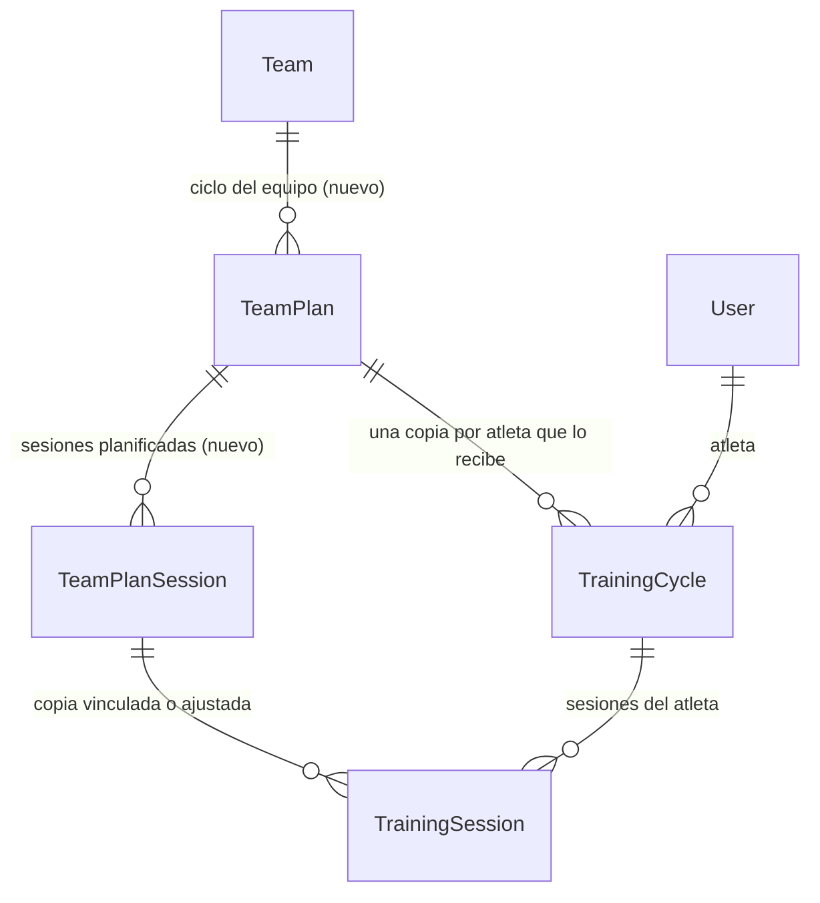

# Ciclo del equipo (CYC-316, ampliación; desarrollo en CYC-314)

El botón «Agregar ciclo» de Equipos → Ciclos crea un ciclo para el equipo, con un calendario donde el coach asigna sesiones que llegan a cada integrante. Primera versión simple, **solo web del coach**. Maquetas en [propuestas.html](propuestas.html) y capturas en `capturas/`.

## Decisiones de la usuaria (25-11)

1. Un cambio en la sesión del equipo se aplica a los integrantes.
2. Un cambio en la ventana de un atleta afecta solo a su sesión y nunca a la planificación del equipo.
3. Al agregar un atleta al equipo se pregunta si se le asigna el ciclo; recibe las sesiones desde ese día.
4. Al sacar un atleta conserva lo registrado y las sesiones ajustadas para él; se quitan sus demás sesiones futuras del ciclo del equipo, avisando antes.
5. Si un atleta ya tiene ciclo propio en esas fechas, conviven; antes de crear el ciclo se avisa quiénes lo tienen y el coach decide por persona.

## Por confirmar con la usuaria

Nada de esta lista está aprobado; las maquetas lo muestran como propuesta.

1. Una sesión ajustada en la ficha del atleta queda separada y deja de recibir los cambios del equipo.
2. Las sesiones ya registradas nunca cambian.
3. Un cambio del equipo llega solo a copias enlazadas, sin ajustar, pendientes, sin empezar y de hoy en adelante.
4. Con invitación pendiente no se puede crear el ciclo: aparece deshabilitado y se suma a mano cuando acepte.
5. En la primera versión el equipo tiene un solo ciclo por fechas (hay estado de error).
6. Eliminar el equipo o su ciclo sigue la misma regla que sacar a un atleta, con aviso y cifras.
7. Con ciclo propio y del equipo, «Hoy» del atleta muestra la sesión de hoy y, si no hay, la más cercana en fecha (propuesta de Desarrollo; falta diseñar cómo se distinguen).

La propuesta técnica de Desarrollo general, con su diagrama, está en el comentario de CYC-314.

## Pantallas

| Paso | Captura |
|---|---|
| Equipo sin ciclo | `equipo-sin-ciclo` |
| Nuevo ciclo: nombre, objetivo, tipo, inicio y duración | `nuevo-ciclo-datos` |
| Quién lo recibe, con aviso de ciclos propios | `nuevo-ciclo-quien-recibe` |
| Fechas ocupadas por otro ciclo del equipo | `nuevo-ciclo-fechas-ocupadas` |
| Pizarra del equipo | `pizarra-del-equipo` |
| Menú de sesión y resumen tras guardar | `menu-de-sesion` |
| Quién lo recibe y qué tiene de distinto | `quien-lo-recibe` |
| Editar la sesión del equipo | `editar-sesion-del-equipo` |
| Editar desde la ficha de un atleta | `editar-sesion-de-un-atleta` |
| Un atleta entra al equipo | `atleta-entra` |
| Un atleta sale del equipo | `atleta-sale` |
| Eliminar el equipo | `eliminar-equipo` |
| Ficha de novedad | `novedad-coach` |

## Reglas del diseño

- **Se reutiliza la pizarra** (`docs/diseno/ciclos-pizarra`, variante A): rutinas a la derecha, «+» por día, arrastrar, menú ⋯, autoguardado y Deshacer. Los días pasados no aceptan sesiones.
- **Sin «sesiones por semana»**: el plan del equipo se organiza por fechas.
- **Cada tarjeta del equipo** dice a cuántos atletas llega; las pasadas, cuántos la hicieron; «N ajustada» cuando hay copias separadas. Esas cifras se calculan con las sesiones de cada atleta, porque el plan del equipo no tiene atleta.
- **Después de guardar** un cambio se informa a cuántos llegó y cuántos no cambiaron, y por qué.
- **El plan del equipo no tiene atleta:** no muestra series, RM ni «Sin RM» por persona. El % del RM está siempre disponible y el peso se calcula en la copia de cada atleta; a quien no tiene RM le llega el % sin peso con el aviso «Falta el RM».
- **En la ficha del atleta** la sesión muestra «Del equipo», «Ajustada» o «Registrada», y editarla avisa que el cambio es solo para esa persona.
- **Invitación pendiente**: aparece deshabilitada, con la razón.
- Los avisos de sacar a un atleta o eliminar el equipo dan las cifras de lo que se quita y lo que se conserva.
- Esquinas casi rectas, sin negritas pesadas ni líneas grises bajo los títulos.

## Modelo (idea conceptual)

La propuesta técnica la prepara Desarrollo general (CYC-314). Este diagrama solo muestra las relaciones que el diseño necesita.

Cada copia necesita saber si sigue vinculada o quedó ajustada. La migración va con respaldo previo y el «apruebo» de la usuaria, antes que la de `TeamEvent` (CYC-317).

## Ficha de novedad

`coach-team-cycle@1`, 1 slide, solo coach: «Planifica el ciclo de tu equipo» · «Pon las sesiones una vez en el calendario del equipo y llegan a cada integrante.»

## Fuera de la primera versión

- Más de un ciclo del equipo a la vez en las mismas fechas, plantillas desde la Biblioteca y macrociclos de equipo.
- Volver a vincular una sesión ajustada.
- Cómo distinguir dos ciclos en «Hoy» del atleta y en las tarjetas del coach (queda por diseñar).
- App móvil.
