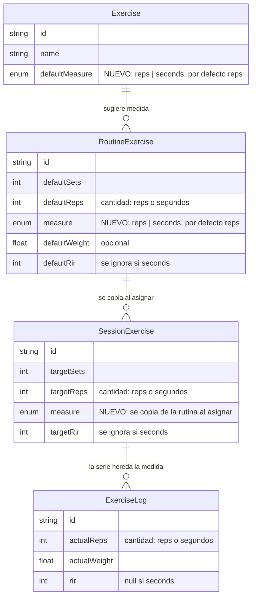

# Ejercicios por tiempo además de por repeticiones (CYC-296)

> Contrastado con `origin/main` (2026-11-19). Estado: **propuesto, a la espera del «apruebo»**. Sin cambios de código. Maquetas en [`propuestas.html`](propuestas.html); capturas en `capturas/`. Origen: solicitud de la activación presencial del 18-11 («30 segundos de skipping»).

## Qué hay hoy

- `RoutineExercise.defaultReps`, `SessionExercise.targetReps` y `ExerciseLog.actualReps` son enteros obligatorios. El único tiempo del modelo es el descanso (`defaultRestSeconds` / `targetRestSeconds`).
- La fila del constructor web tiene Ser., Reps, Carga, Desc. y RIR ([`ExerciseRowEditor.tsx`](../../../apps/web/src/components/builder/ExerciseRowEditor.tsx)). La app registra cada serie con pasos de repeticiones y peso, y RIR en la última serie ([`ExerciseLogScreen.tsx`](../../../apps/mobile/src/screens/ExerciseLogScreen.tsx)).
- Hoy y el detalle escriben «3 × 10 · peso corporal». La barra de descanso («Pausa») ya existe y es oscura.

## Decisiones propuestas

| # | Tema | Recomendación | Alternativa |
|---|---|---|---|
| 1 | Coach, en el constructor | **A.** Selector de unidad dentro de la celda («reps ⌄» / «s ⌄»). El catálogo sugiere la unidad por defecto y la marca «Tiempo» en el selector de ejercicios. | B: unidad solo desde el menú ⋯. C: la unidad la fija el ejercicio y no se cambia en la fila. |
| 2 | Atleta, registro | **A.** Cronómetro en la tarjeta de la serie: anillo grande con cuenta regresiva, Iniciar / Pausar / Seguir, y «Registrar sin cronómetro». | B: campo de segundos como hoy más una barra de cronómetro al pie (parece la barra de descanso). |
| 3 | Carga y RIR | **Carga sigue opcional** (plancha con disco, saltos con chaleco). **RIR no aplica**: en la fila se apaga y la app no lo pide. | Pedir RIR igual (no tiene sentido para 30 s de skipping). |
| 4 | Cómo se escribe el tiempo | Segundos (de 1 a 3600); se muestra «30 s» y desde 60 «1:30». | Campo mm:ss (más lento de teclear). |
| 5 | Antes de empezar | Cuenta de preparación de 3 s, con «Saltar». | Empezar de inmediato. |
| 6 | Al llegar a cero | Vibración en app y sonido corto (en web, silenciable). El tiempo realizado queda editable antes de guardar. | Guardar solo, sin confirmar. |
| 7 | Cambiar la unidad con series ya registradas | **Bloqueado** (igual que «Quitar» con series registradas). Se duplica el ejercicio. | Permitirlo y reinterpretar el historial (no). |

## Qué se ve en cada lugar

| Lugar | Ejercicio por repeticiones | Ejercicio por tiempo |
|---|---|---|
| Constructor (web) | Ser., «10 reps ⌄», Carga, Desc., RIR | Ser., «30 s ⌄», Carga, Desc., RIR apagado |
| Hoy y detalle (app y web) | `3 × 10 · peso corporal` | `3 × 30 s · peso corporal` |
| Registro de la serie | Pasos de repeticiones y peso | Anillo con cuenta regresiva, y «Tiempo realizado» con − / + de 5 s |
| Serie guardada | `10 reps · peso corporal` | `30 s · peso corporal` |
| Resumen de bloque | `2 ejercicios, 5 series` | Igual: cuenta series, no unidades |

El **tiempo de trabajo** (anillo azul, sobre la tarjeta) no se parece al **descanso** (barra oscura al pie, ya existente): son dos cosas distintas. Riesgo: la barra se llama «Pausa» y el botón del cronómetro «Pausar». Si molesta, el botón pasa a «Detener» / «Seguir».

No hay pantallas de Resumen en las maquetas (regla vigente).

## Cambio de modelo (diagrama)

Recomendado: una columna `measure` por fila y se reutiliza la columna numérica existente, que pasa a significar «cantidad» (repeticiones o segundos). Es **aditivo**: todo lo existente queda en `reps`, sin tocar datos.

Alternativa (no recomendada): columnas nuevas `defaultSeconds`, `targetSeconds`, `actualSeconds` y volver nulas las de repeticiones. Nombres más honestos, pero cambia la nulabilidad de tres columnas que hoy leen API, web, app, progreso y seeds.

Reglas del modelo que el diseño da por sentadas:

- La medida del registro se hereda de `SessionExercise`; `ExerciseLog` no la repite.
- `measure` no cambia si la serie ya tiene registros.
- El progreso por ejercicio (`exercise-progress.ts`) compara repeticiones y peso: para ejercicios por tiempo debe comparar segundos y no mezclarlos con repeticiones.
- Los avisos de carga se apoyan en RIR: sin RIR, un ejercicio por tiempo no los genera.

## Lo que falta para desarrollar (tarjetas bloqueadas por esta)

| # | Trabajo | Dónde |
|---|---|---|
| 1 | Migración aditiva + enum `Measure` (respaldo antes, aprobación de la usuaria antes de migrar) | `apps/api/prisma` |
| 2 | `measure` en los DTO de rutinas, estructura de sesión, agregar/editar ejercicio y registro de serie, con validación de rango | `apps/api/src/routines`, `sessions`, `execution` |
| 3 | Progreso por ejercicio en segundos; evitar mezclarlo con repeticiones | `exercise-progress.ts` y su espejo en la app |
| 4 | Constructor web: selector de unidad, RIR apagado, marca «Tiempo» en el selector, `Exercise.defaultMeasure` en crear/editar ejercicio | `apps/web` |
| 5 | Registro del atleta con cronómetro (web y app); el tiempo se calcula con la hora de inicio, no contando intervalos, para seguir bien con la pantalla bloqueada o en segundo plano | `apps/web`, `apps/mobile` |
| 6 | Hoy, detalle y formato `30 s` / `1:30` en un solo helper compartido | `packages/shared` |
| 7 | Ficha de novedad | ver abajo |

## Ficha de novedad (popup)

Dos fichas, porque cada rol la ve en su plataforma. Textos de hasta 140 caracteres (miden 95, 81, 101 y 77).

- `coach-time-exercises@1` (web, coach), 2 slides: «Ejercicios por tiempo» («Ahora un ejercicio puede medirse en segundos, como 30 s de skipping, y no solo en repeticiones.») y «Elige la unidad en cada fila» («En el constructor, toca la unidad junto al número y cambia entre reps y segundos.»). Demos nuevas: `time-row-unit`, `time-row-rir`.
- `athlete-time-exercises@1` (app y web, atleta), 2 slides: «Cuenta regresiva en tu sesión» («Cuando un ejercicio es por tiempo, toca Iniciar y mira cómo baja. Al llegar a cero, guardas tu serie.») y «Corrige tu tiempo real» («Si paraste antes o te pasaste, ajusta los segundos antes de guardar la serie.»). Demos nuevas: `time-countdown`, `time-adjust`.

No hace falta un tour nuevo.

## Accesibilidad

- El número del anillo mide 66 pt y es texto, no solo color; el estado va en palabras («para empezar», «quedan», «en pausa», «¡Listo!»).
- Botones de 56 pt de alto. El anillo con progreso es gráfico de más de 3:1 contra el blanco (#3080fc, 3,7:1; en pausa gris #8d95a3 acompañado de «en pausa»).
- El lector de pantalla no debe anunciar cada segundo: avisar al iniciar, a los 10 s, a los 3, 2, 1 y al terminar (región «polite»).
- «Reducir movimiento»: el anillo salta de valor sin animación.
- Evitar que la pantalla se apague mientras corre el cronómetro (mantener despierta).

## Preguntas para la usuaria

1. Constructor del coach: ¿A (selector en la celda, recomendada), B o C?
2. Registro del atleta: ¿A (cronómetro en la tarjeta, recomendada) o B (barra al pie)?
3. ¿Carga opcional y RIR apagado en los ejercicios por tiempo?
4. ¿Segundos (de 1 a 3600) o mm:ss?
5. ¿Cuenta de preparación de 3 s antes de empezar?
6. ¿Bloquear el cambio de unidad cuando la serie ya tiene registros?
7. Modelo: ¿una columna `measure` reutilizando la cantidad (recomendado) o columnas nuevas en segundos?
