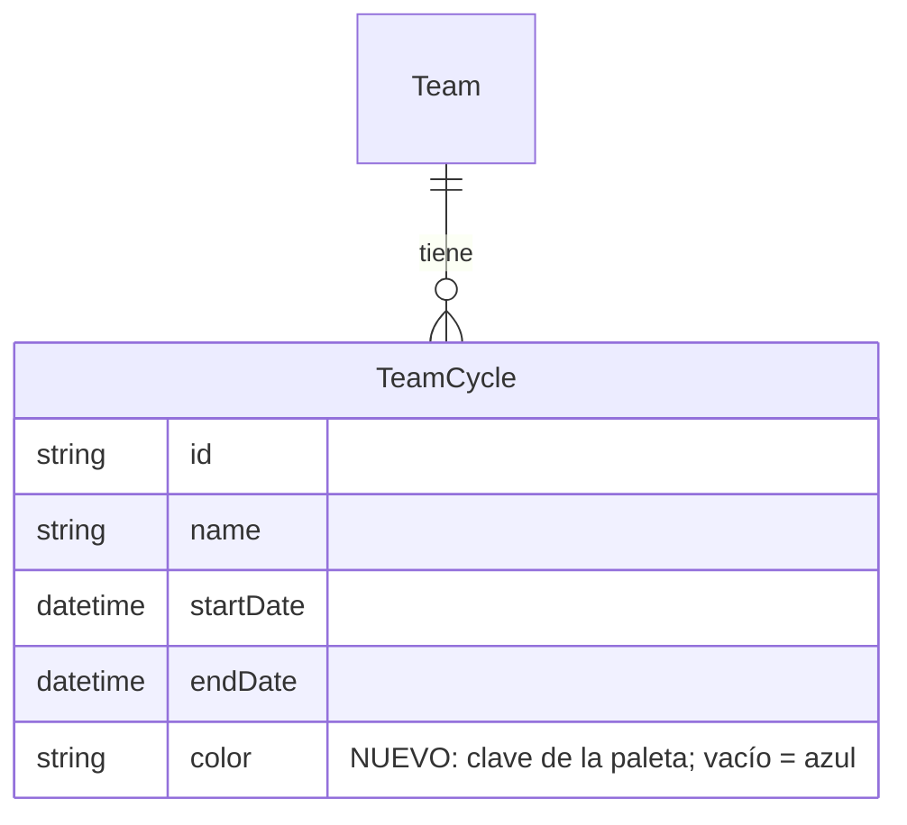

# Equipos a todo el ancho, calendario solo del equipo y panel de sesión (web del coach)

**Estado (27-11):**
- **Aprobado por la usuaria en el chat de diseño:** las tres partes.
- **Aprobado según Organización (lo escribió en ese chat):** la barra continua. Además pidió ahí
  elegir el color cuando hay más de un ciclo y dejar en el encabezado solo el nombre, en su color.
- **Ordenado por la usuaria en el chat de diseño:** abrir el PR, después de recibir el resumen de esos
  dos ajustes.
- **Sin pronunciamiento aparte:** el diseño de esos ajustes y las cuatro interpretaciones de «Color y
  encabezado».

Tiene tres partes: 1) todo el ancho, 2) el calendario muestra solo lo del
equipo y 3) un panel lateral para ver y editar cada entrenamiento. 

Pedido de la parte 1: el sidebar no está en el borde de la pantalla, el espacio está poco
aprovechado, la letra se ve grande y los selectores no guardan proporción con el texto.

Las capturas «antes» son la web de `origin/main` (`c687743`) corriendo en local con datos ficticios.
Las del calendario y el panel «después» se volvieron a tomar sobre `7a4a13f`.
En las del calendario «después» se ocultó por estilos lo que sale en la parte 2 y la barra del ciclo
se dibuja encima. En `despues-semana-1440.png` las marcas son las de la app actual: no prueban el
filtro de la parte 2. El panel es una maqueta sobre el calendario real.
Las «después» son esa misma web con `propuesta.css` encima. En el Calendario además se movieron los
filtros dentro de la barra. `propuesta.css` es una referencia de medidas, no código para copiar tal
cual: pisa las reglas actuales desde fuera.

## Qué pasa hoy
- El compacto (PR #289) ya está: sidebar de 208 px, título 24 px y controles de 14 px.
- El borde sigue igual: `.app-main` limita Equipos a 1360 px, centrado y con 32 y 24 px de margen.
  Quedan 24 px libres a cada lado en 1280, 64 en 1440 y **304 en 1920**.
- Ciclos corta los nombres a mitad de palabra («Piern / as», «Empu / je»).
- Las tarjetas de rutina ocupan solo parte del panel: «Editar», aunque oculto, les quita espacio.
- Conviven alturas de 32, 34 y 36 px; los selectores miden 210 y 168 px y la flecha toca el borde.

## Propuesta (desde 761 px de ancho)

### Marco
- `.app-main` sin ancho máximo ni márgenes **solo en Equipos**.
- Sidebar pegado al borde izquierdo, a todo el alto y fijo bajo la barra superior al desplazar.
  Sus iconos quedan alineados con el logo (24 px). Contraído sigue en 60 px.
- La barra superior mide 73 px, pero `--app-header-h` vale 57 px: usar la altura real en lo fijo.

### Escala (puntero fino)
| Elemento | Hoy | Propuesta |
|---|---|---|
| Título de la herramienta | 24 px | 20 px |
| Título del mes | 16 px | 15 px |
| Botones, segmentos y selectores | 14 px; 32 a 36 px de alto | 13 px; **32 px de alto** |
| Herramientas del sidebar | 14 px | 14 px (sin cambio) |
| Nombres en tarjetas y tablas | 13 a 16 px | 13 px |
| Datos secundarios | 12 px | 12 px (mínimo) |

La barra superior (Inicio, Atletas…) no cambia: es común a toda la web.

### Selectores
Flecha propia con 10 px de aire a la derecha. Queda un solo selector (parte 2), de 164 px y radio 6 px.

### Calendario
- Una barra: mes, Hoy, flechas, filtros y Semana/Mes a la derecha. Reemplaza la fila de filtros del
  diseño `calendario-equipo-arrastre`; la cuadrícula sube unos 94 px a 1440.
- En anchos menores de 1280 px el filtro puede pasar a una segunda fila.
- Semana: nombres a 13 px, avatar 26 px y marcas de 20 px.
- Panel de rutinas: 232 px, tarjetas a todo el ancho. «Editar» aparece sobre la tarjeta al pasar el
  cursor o con el foco del teclado (sin cursor, siempre visible, y hay que darle su espacio).

### Ciclos
Columna de semana 92 px, menos relleno en cada día y «⋯» en la esquina inferior de la sesión. Los
nombres solo se parten entre palabras.

### Eventos y Rankings
Pegados a la izquierda con **máximo 1200 px**: a 1712 px, el evento y quién participa quedan tan
lejos que cuesta seguir la fila. Filas más bajas: punto 10 px y avatar 26 px.

## Medidas comprobadas
| Ancho | Día del calendario, hoy | Propuesta |
|---|---|---|
| 1280 | 107 px | 112 px |
| 1440 | 118 px | 135 px |
| 1920 | 118 px | 203 px |

Sin desplazamiento horizontal en 1280, 1440 y 1920 en las cuatro herramientas, ni en Calendario a
1101, 1024 y 768. También se probaron la vista Semana y el sidebar contraído a 1440.

## Sin cambios y sin probar
- Teléfono (760 px o menos): no cambia. No se volvió a capturar.
- Pantallas táctiles: reciben el ancho completo, pero conservan tamaños de control. Sin probar.
- Cuadros de diálogo, arrastre, estados vacíos y Safari: sin probar con la propuesta.
- Bloques con esquinas de 12 px en Ciclos: dentro de Equipos pasan a 5 y 6 px.

## Otras páginas
Mismo criterio posible en la pizarra del ciclo de un atleta (usa las mismas piezas y el mismo límite
de 1360 px) y en Biblioteca y Ejercicios (límite de 1120 px según `layout.css`). No se revisaron en
pantalla y **no cambian sin una decisión aparte**.

---

# Barra del ciclo (reemplaza la línea azul de cada día)

Pedido del 27-11: que el período con ciclo se marque con **una línea que lo abarque entero y lleve
el nombre del ciclo**. Capturas: `despues-calendario-*`, `banda-diciembre-1440` y
`despues-semana-1440`. Diciembre muestra dos ciclos de prueba, con fin, hueco e inicio.

- Una barra continua sobre los días del ciclo, **de 20 px**, con el nombre en blanco a 12 px y peso
  500.
- **Un tramo por semana**, con el nombre al comienzo de cada uno, para saber qué ciclo es aunque no
  se vea su primera semana.
- El color de cada barra es el de su ciclo.
- **Inicio y fin reales:** borde de 4 px de radio y 4 px de aire. Donde sigue en otra semana o mes,
  el borde es recto y llega hasta el final de la fila.
- También cubre los días de otro mes visibles en la cuadrícula, para no cortarse.
- Sin ciclo, no hay barra ni espacio reservado. Dos ciclos no se cruzan: el equipo tiene uno por
  fechas. Los archivados no se muestran, como hoy; los terminados usan la misma barra.
- Un nombre que no cabe termina en «…» y se lee completo al pasar el cursor.
- **Semana:** una fila propia entre los días y «Plan del equipo». En teléfono, la lista del plan no
  cambia; en Mes la barra se desplaza con la cuadrícula. El teléfono no se capturó.
- Es informativa: no recibe clics y no tapa el destino al arrastrar. Los fondos de «Soltar aquí» y
  de día rechazado se mantienen. El arrastre con la barra no se probó.
- Lectores de pantalla: el nombre y las fechas se leen en el botón del encabezado; la barra no los
  repite.
- **Costo:** cada semana con ciclo mide unos 24 px más.

## Color y encabezado

Pedido (textual, transmitido por Organización): «necesito que si hay más de un ciclo se pueda
seleccionar el color de la barra y que en el encabezado no aparezca la fecha, solo el nombre y
destacado en el color que tiene la barra». Capturas: `color-menu-1440`, `color-un-ciclo-1440` y
`banda-diciembre-1440`.

### Encabezado
- Cada ciclo que se ve es **solo su nombre**, en blanco sobre su color (13 px, 28 px de alto, radio
  5 px), en orden de fechas y en una sola fila que se envuelve si no cabe.
- La fecha no se muestra. Los lectores de pantalla sí la oyen: «Ciclo Pretemporada, del 21 dic al
  31 ene 2027».
- «El encabezado» es la franja del ciclo sobre el calendario. El título del mes y la cabecera de
  Ciclos no cambian.

### Dónde y quién elige
- **El coach dueño del equipo**, desde el Calendario: el nombre lleva una flecha y abre un menú con
  «Color de la barra» y «Ver ciclo».
- Se guarda al elegir; la barra y el nombre cambian juntos. Si falla, vuelve al color anterior y
  avisa. Se cambia de vuelta eligiendo otro color.
- El menú se recorre con el teclado, el elegido lleva ✓, Escape cierra y devuelve el foco al nombre.
- El color es del ciclo del equipo. No cambia nada en la app ni en la ficha del atleta.

### Paleta cerrada
| Color | Valor | Contraste del texto blanco |
|---|---|---|
| Azul (por defecto) | `#1b66dc` | 5,28:1 |
| Violeta | `#6d45c4` | 6,37:1 |
| Turquesa | `#0f766e` | 5,47:1 |
| Magenta | `#a82d6b` | 6,46:1 |
| Café | `#7c5232` | 6,75:1 |
| Grafito | `#3d4451` | 9,79:1 |

Todos superan 4,5:1. No hay rojo, verde ni naranja, que ya significan rechazado, hecho y atención.
No se comprobó cómo se distinguen entre sí con daltonismo; por eso **el color nunca es la única
señal**: el nombre está en cada barra y en el encabezado, y el menú nombra cada color.

### Color por defecto y repetidos
- El primer ciclo es azul. Un ciclo nuevo recibe el primer color de la lista que no use otro ciclo
  no archivado del equipo; si ya se usan todos, azul.
- Los ciclos que ya existen quedan en azul hasta que se elija otro.
- Se puede repetir un color: el menú muestra el nombre de otro ciclo que ya lo usa.

### Con un solo ciclo
El nombre conserva su color guardado, no lleva flecha ni menú, y al tocarlo abre Ciclos.

### Interpretaciones pendientes de que las vea
1. **«Más de un ciclo»** = el equipo tiene dos o más no archivados, aunque en el mes se vea uno.
2. Si vuelve a quedar uno, **conserva su color** y se oculta el selector.
3. **«Solo el nombre»:** además de la fecha, salen «4 de 4 atletas» y el botón «Ver ciclo». Se llega
   al ciclo desde el nombre. Cuántos lo reciben se sigue viendo en Ciclos y en cada sesión.
4. El selector está solo en el Calendario, no en «Agregar ciclo» ni en «Datos del ciclo».

### Requiere cambiar la base y la API
`TeamCycle` no tiene color en `origin/main` (`7a4a13f`). **Este diseño no escribe la migración.**

API: guardar el color al crear el ciclo, aceptarlo al actualizarlo (solo valores de la paleta y solo
el coach dueño) y devolverlo en la lista y el detalle. Revisar si «Descargar mis datos» debe
incluirlo. Sin ese cambio se puede construir la barra y el encabezado en azul, sin selector.

---

# Parte 2: el calendario muestra solo lo del equipo

Decidido por la usuaria el 27-11 (lo transmitió Organización). Reemplaza esa parte del diseño
aprobado `calendario-equipo-arrastre`. Desventaja que se le explicó: al planificar desde el equipo
no se ven los compromisos personales; siguen en la ficha de cada atleta.

## Qué se ve y qué no
| Se ve | Ya no se ve |
|---|---|
| Sesiones del plan del equipo, una vez, con «N ajustadas» | Sesiones de «Ciclo propio» |
| Eventos del equipo | Sesiones «De otro equipo» |
| | Actividades personales (entrenamiento, partido, descanso y las demás) |

- Una sesión ajustada y movida a otro día desde la ficha no aparece en su día nuevo: se ve la del
  plan, en su día, con «1 ajustada».
- Si la sesión del equipo se quita y queda una ajustada, la copia pierde el enlace con el plan
  (`teamSessionId` queda vacío) y **deja de verse en el calendario del equipo**. Sigue en la ficha.

## Filtros
- Se quita «Todas las personas»: solo filtraba lo personal; el plan es el mismo para todos. También
  se va el aviso «Estás viendo a una persona…».
- El filtro de tipo queda con «Todos los tipos», «Sesiones» y «Eventos del equipo». Sale
  «Actividades de los atletas». Con «Eventos del equipo» no se puede asignar rutinas, como hoy.

## Semana
- La fila «Plan del equipo» no cambia.
- Las marcas de cada atleta cuentan **solo copias de sesiones del plan de este equipo**, incluidas
  las ajustadas. Hoy cuentan todas sus sesiones. Un día sin sesión del equipo queda vacío.
- En teléfono, igual.
- **Copia ajustada y movida:** su marca va en el día nuevo, no en el del plan.

### De dónde sale la fecha de cada marca
El detalle del ciclo del equipo no trae la fecha de las copias (trae sesión, atleta, estado y
«ajustada»). **No sirve por sí solo para la Semana:** pondría la movida en el día del plan.

| Camino | ¿Cambia la API? |
|---|---|
| Seguir consultando las sesiones de cada atleta, como hoy, y filtrar las del plan de este equipo | No |
| Armar la Semana solo con el detalle del ciclo, con menos consultas | **Sí:** cada copia debe traer su fecha |

## Conteos y dependencias
- «Llega a N», «9 de 10», «N ajustadas», «4 de 4 atletas» y «4 atletas» salen del plan: no cambian.
- **El arrastre, el «+» y el panel de rutinas no dependían de las sesiones propias.** El calendario
  no tiene aviso de choques del mismo día: solo revisa si el día es pasado, si hay ciclo y, al
  mover, que sea del mismo ciclo. Lo que se pierde es la comparación a simple vista.
- El «Choque de carga» está en **Eventos**, que además lista actividades de los atletas. No cambia;
  el pedido fue sobre el calendario. Rankings tampoco cambia ni se revisó con este criterio.
- Para Desarrollo: Mes deja de necesitar las consultas de sesiones por atleta. Semana las sigue
  necesitando mientras las copias no traigan fecha. No se midió cuántas consultas quedan.

---

# Parte 3: panel lateral de la sesión del equipo

## Abrir
- Clic en una sesión del equipo en Mes, en «Plan del equipo» de Semana o en la lista del teléfono.
  La tarjeta es un botón: también abre con Intro o Espacio. Arrastrarla no abre el panel.
- Panel de 520 px desde la derecha, a todo el alto, con velo suave. Es modal: tapa el panel de
  rutinas y mientras está abierto no se arrastra. Al cerrar, todo vuelve como estaba y el foco
  regresa a la tarjeta.
- Los eventos del equipo siguen abriendo Eventos.

## Contenido y edición
- Cabecera: nombre, fecha, «⋯» y cerrar.
- Arriba, **a quién llega y quién queda fuera, con nombres y motivo**. Con más de tres excluidos:
  «3 no cambian» y «Ver quiénes».
- Por ejercicio, agrupado por bloque: series, repeticiones y carga (kg o % del RM). En el «⋯» de la
  fila: «Descanso y nota», «Subir», «Bajar» y «Quitar». «Agregar ejercicio» usa el buscador actual y
  lo agrega al final, sin bloque.
- No se editan aquí: nombre, bloques ni RIR (se conservan). El día se cambia con «Mover a otro día…».

## Cuándo es solo lectura
| Caso | En el panel |
|---|---|
| Hoy o futura, con alguien que reciba el cambio | Editable. Lo registrado y lo ajustado no cambia |
| Día pasado | Solo lectura: ejercicios, quién la hizo, enlace a cada sesión y «Duplicar en otro día…» |
| Hoy o futura, nadie la recibe (todos registraron o ajustaron) | Solo lectura, con el motivo y «Duplicar» |
| Ciclo terminado o archivado | Solo lectura |

## Guardar y deshacer
- **Guardado explícito** con «Guardar para N atletas», no automático: cada guardado cambia lo que ve
  cada atleta y puede enviarle un aviso.
- Al guardar, el panel sigue abierto y muestra cuántas cambiaron y cuántas no, con «Deshacer»
  durante 8 segundos, como hoy. Deshacer vuelve a guardar la versión anterior para quienes aún
  pueden recibirla; no borra nada registrado.
- Si falla: error arriba del panel, se conservan los valores y se puede reintentar. Campos no
  válidos: se marcan, con el mensaje actual.

## Cerrar con cambios
✕, Escape, el velo, «Atrás» del navegador y las acciones de «⋯» preguntan «¿Descartar los cambios?».
«Seguir editando» es la opción por defecto. Al recargar o cerrar la pestaña, el aviso del navegador.
Escape cierra primero el menú abierto. «Descartar cambios», en el pie, vuelve a lo guardado.

## Menú «⋯» y arrastre
- En la tarjeta se mantiene para mover, duplicar y quitar sin abrir el panel. «Editar ejercicios»
  pasa a «Ver y editar» y abre el panel. En días pasados conserva lo de hoy.
- La cabecera del panel tiene las mismas acciones. Mover o duplicar usa el selector de días actual;
  quitar pide la misma confirmación y cierra el panel.
- El día no se guarda junto con los ejercicios: son dos pedidos distintos a la API.

## Teclado y anchos
- Foco atrapado en el panel; empieza en «Cerrar». Orden: cabecera, alcance, ejercicios y pie. Cada
  campo se nombra con su ejercicio. El resultado del guardado se anuncia (`role="status"`).
- 761 a 1100 px: 520 px, dejando al menos 56 px de calendario.
- Teléfono: pantalla completa, pie fijo, y cada ejercicio con el nombre arriba y los tres campos
  abajo. El «+» y su comportamiento no cambian.

## Qué se reutiliza
`TeamSessionDialog` (su formulario pasa al panel y el cuadro desaparece del calendario), `rowsOf`,
`fromRows`, `structureOf`, `editReach`, `savedMessage`, `LoadCell`, `ExercisePicker`,
`useDialogFocus`, `useTeamPlanActions`, `TeamSessionActions`, `DayPicker`, `ConfirmDialog` y
`UndoToast` (debe verse dentro del panel). `fromRows` hoy solo cambia filas existentes: hay que
ampliarlo para agregar, quitar y reordenar, y para descanso y nota.

## ¿Alcanza la API? (revisado en el código, sin probar; no se cambió)
- **Abrir:** sí, con el alcance de abajo. El detalle del ciclo ya trae ejercicios, bloques y copias; no
  necesita otra consulta.
- **Guardar:** sí. `PUT /team-sessions/:id/structure` admite cambiar, agregar, quitar y reordenar.
- **Falta 1, alcance exacto antes de guardar:** las copias traen estado y «ajustada», pero no si la
  persona ya empezó o registró series y sigue pendiente. La API no le aplica el cambio, pero el
  panel no puede saberlo antes: prometería una persona de más. El mensaje al guardar sí es exacto.
  Propuesta para Desarrollo: que cada copia diga si recibe el cambio y, si no, el motivo.
- **Falta 2, fecha de las copias movidas:** el panel puede decir que alguien tiene la sesión ajustada,
  pero no si la movió ni a qué día. Con la API actual el panel dice solo «tiene la sesión ajustada»;
  en un día pasado, la lista dice el estado de cada persona sin dar a entender que fue ese día, y
  «Ver su sesión» lleva a la suya, donde está la fecha. Para mostrar «ajustada, movida al sábado 28»
  **hay que ampliar la respuesta** con la fecha de cada copia. Conviene hacerlo junto con la falta 1.
- **Cuidado al deshacer:** si se quitó un ejercicio, el deshacer actual enviaría un `id` que ya no
  existe y la API lo rechaza («Uno de los ejercicios no es de esta sesión»). Hay que reenviarlo sin
  `id` (igual los bloques eliminados), y se crea de nuevo.

## Ficha de novedad propuesta: `coach-team-session-panel@1`
Web, coach. Nombre: «Editar desde el calendario».
1. **Abre un entrenamiento** / «Haz clic en un entrenamiento del calendario: su detalle se abre a la derecha.»
2. **Edítalo sin salir** / «Cambia ejercicios, series y carga. Antes de guardar ves a quiénes llega el cambio y a quiénes no.»
3. **Solo lo del equipo** / «El calendario muestra entrenamientos y eventos del equipo. Lo de cada atleta sigue en su ficha.»

4. **Cada ciclo, su color** / «Su nombre va en la barra. Si tienes más de un ciclo, tócalo arriba para elegir el color.»

La lámina 4 se incluye solo si el selector ya está construido. Las demostraciones animadas se definen al construirla. `coach-team-calendar@1` sigue siendo válida.

## Propuestas aparte (no incluidas)
- **Mismo panel en Ciclos:** recomendable, para no tener dos editores. Hoy comparte el cuadro
  «Editar ejercicios».
- **Panel para eventos del equipo:** posible después; no se pidió.
