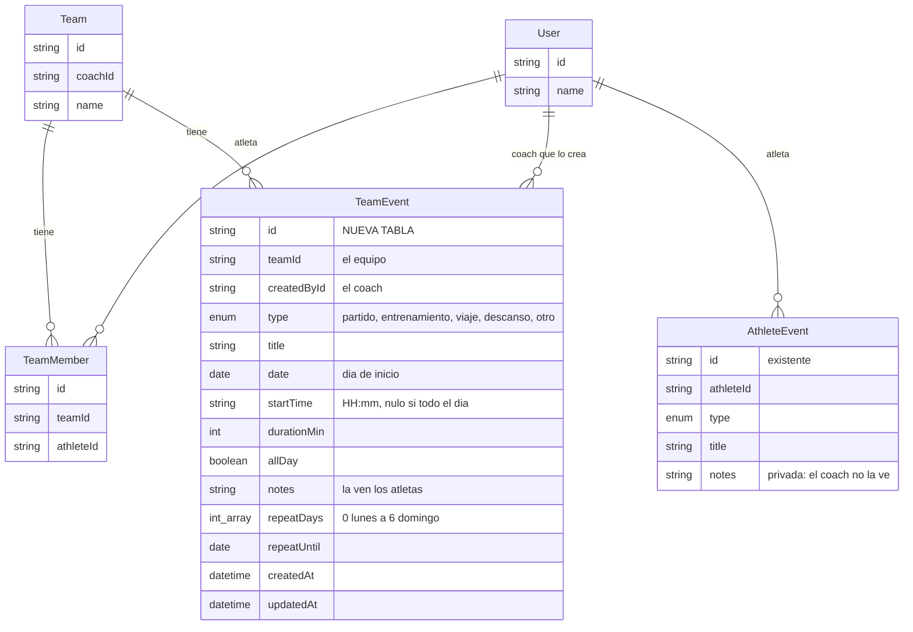

# Equipos con sidebar (CYC-316)

Rediseño de la pestaña Equipos (CYC-308): la navegación dentro de la pestaña pasa a un sidebar con un selector de equipo y cuatro herramientas. Maquetas en [propuestas.html](propuestas.html) y capturas en `capturas/`.

## Lo que pidió la usuaria

- Un sidebar simple, expandido y contraído (como el ejemplo que compartió).
- Un **selector desplegable** para elegir el equipo con el que se trabaja, y no un campo por equipo.
- Debajo, las herramientas del equipo: **Calendario, Ciclos, Eventos y Rankings**.
- Sin negritas pesadas.
- Sin formas redondeadas en todo: se ve «generado por IA». Botones, campos, tarjetas, etiquetas y cuadros usan esquinas casi rectas (4 a 6 px, 8 px en cuadros y menús). Solo siguen redondos los avatares de personas y los círculos de color de estado.

## Qué cambia respecto de CYC-308

| Antes (CYC-308) | Ahora |
|---|---|
| Lista de tarjetas de equipos y detalle aparte | Selector de equipo en el sidebar; no hay pantalla de lista |
| Detalle con la tabla de atletas | Cuatro herramientas: Calendario, Ciclos, Eventos y Rankings |
| «Agregar atletas», «Quitar», Renombrar y Eliminar en el detalle | Salen del botón «12 atletas» y del menú ⋯ del encabezado |
| «Crear equipo» en la lista | «Crear equipo» al pie del selector desplegable |
| Textos en negrita pesada | Peso normal y medio en el sidebar, los títulos y las tablas |

El modelo de datos (`Team` y `TeamMember`) y los cuadros de crear, agregar, renombrar y eliminar no cambian.

## Decisiones del diseño

1. **Sidebar** con, de arriba abajo: botón para contraer, selector del equipo (inicial con color, nombre y una flecha) y la lista «Herramientas» (Calendario, Ciclos, Eventos y Rankings) con ícono y nombre. La herramienta activa va en gris.
2. **Selector desplegable**: lista los equipos con su cantidad de atletas, el actual en gris, y «Crear equipo» al final.
3. **Contraído**: columna angosta con la inicial del equipo y los cuatro íconos; el nombre se ve al pasar el cursor.
4. **Calendario** (vista inicial), con el formato de la referencia de la usuaria (calendario de contenido): título «Calendario» con «Agregar rutina», fila de filtros (**Todos los tipos** y **Todas las personas**) y debajo la cuadrícula del **mes** (Lun a Dom), con el mes y la zona horaria, el selector **Semana | Mes**, «Hoy» y las flechas. Los días de otros meses van en gris y hoy lleva una marca oscura. Cada día muestra tarjetas con perla de color, nombre truncado y una etiqueta: las **sesiones del equipo** con cuántos atletas las hicieron («10 de 12», «Pendiente»), los **eventos del equipo** con «Equipo» y, en una línea de texto, lo que agregaron los atletas («Viaje: Matías»). El modo **Semana** muestra una fila por atleta con una marca por día.
5. **Ciclos**: el ciclo vigente de cada atleta, la semana en que va y su avance; «Agregar ciclo».
6. **Eventos**: dos tipos de fila en la misma lista, por día y semana. **Los del equipo** los crea el coach (fondo suave, «Todo el equipo» y menú ⋯ con Editar y Eliminar). **Los de los atletas** son lo que cada uno agregó por su cuenta fuera del plan (CYC-237): solo lectura y sin sus notas (R7). Cada uno con la perla de color de su tipo, la hora y quiénes participan. Arriba, el aviso «Choque de carga».
   - **Agregar evento** abre «Nuevo evento para <equipo>»: tipo (partido o competencia, entrenamiento, viaje, descanso activo, otro), nombre, fecha, hora, duración, todo el día, días en que se repite y una nota para los atletas.
   - **Lo ve el atleta** en su calendario, con el nombre del equipo, sin poder editarlo; si lo quitan del equipo, deja de verlo. El evento no se copia: se lee por la pertenencia al equipo.
   - **Editar o eliminar** una serie cambia todas sus repeticiones.
7. **Rankings**: atletas ordenados por el porcentaje de sesiones completadas sobre las asignadas, con selector de período (últimas 4 semanas o este ciclo).
8. **Atletas del equipo**: el botón «12 atletas» abre un cuadro con la lista, «Quitar» y «Agregar atletas». El menú ⋯ trae Renombrar y Eliminar equipo.
9. **Sin equipos**: el selector dice «Sin equipos», las herramientas aparecen apagadas y el centro invita a crear el primero.
10. **Pantalla angosta**: el selector queda arriba y las herramientas pasan a pestañas (solo la activa muestra su nombre).

## Para Desarrollo general

- Rutas: `/equipos` abre el primer equipo en Calendario; `/equipos/:id/calendario`, `/ciclos`, `/eventos` y `/rankings` para cada herramienta.
- Afecta al PR #269 (CYC-310): `TeamsPage` y `TeamDetailPage` se reemplazan por un contenedor con el sidebar y las cuatro vistas.
- Eventos de atletas: reutiliza `AthleteEvent` (CYC-251/253) agrupado por los atletas del equipo, sin cambios.
- **Eventos del equipo: modelo nuevo** (tabla `TeamEvent`, ver el diagrama). La migración es aditiva y va en tarjeta aparte, con respaldo previo y el «apruebo» de la usuaria.
- API: `GET/POST /teams/:id/events`, `PATCH/DELETE /teams/:id/events/:eventId` (coach dueño) y los eventos del equipo dentro del calendario del atleta (lectura).
- Calendario reutiliza el cálculo de la semana de Atletas; Ciclos, el ciclo vigente que ya trae el detalle del equipo; Rankings usa el mismo dato de cumplimiento de la tarjeta del atleta (últimas 4 semanas), calculado por equipo.
- Rankings puede necesitar un endpoint de lectura por equipo, a definir con Desarrollo general.

## Cambio de modelo (diagrama)

- `TeamEvent` es de solo escritura del coach dueño del equipo. El atleta lo lee por su pertenencia a `TeamMember`; no se copia a `AthleteEvent`.
- Al borrar un equipo se borran sus eventos. Al quitar a un atleta del equipo, deja de ver los eventos.
- La nota la ven todos los atletas del equipo: el formulario avisa que no debe llevar datos de salud (R7).
- Reutiliza el tipo de evento de `AthleteEvent` (partido, entrenamiento, viaje, descanso activo, otro).

## Fichas de novedad (popup)

- `coach-team-events@1`, 1 slide, solo coach: «Crea eventos para todo el equipo» · «Agrega un partido o un viaje una vez y cada atleta lo ve en su calendario.»
- `athlete-team-events@1`, 1 slide, solo atleta: «Eventos de tu equipo» · «Tu coach agrega partidos y viajes del equipo, y los ves en tu calendario.»

## Preguntas abiertas

1. ¿Calendario, Ciclos, Eventos y Rankings muestran lo descrito arriba? Es mi interpretación.
2. ¿Agregar y quitar atletas, renombrar y eliminar salen del botón «12 atletas» y del menú ⋯? Propongo que sí.
3. ¿El ranking es solo por sesiones completadas, o hay otro criterio? Propongo empezar solo con ese.
4. ¿Los atletas reciben un aviso cuando el coach crea un evento del equipo? Propongo que no al inicio: lo ven en su calendario.
5. ¿Editar o eliminar un evento repetido cambia toda la serie? Propongo que sí, y dejar «solo este día» para después.
6. ¿El sidebar recuerda si quedó contraído o expandido? Propongo que sí.
