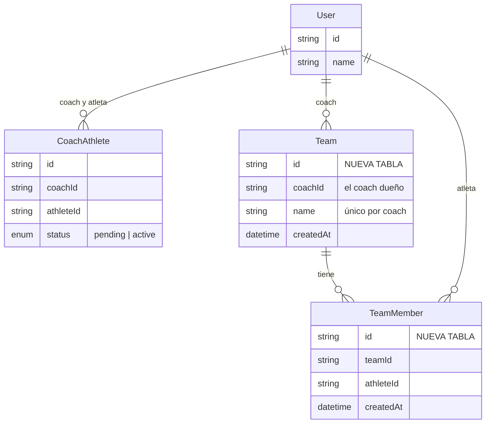

# Sección Equipos (CYC-308)

Pestaña nueva en la web del coach para llevar los equipos por separado de los atletas: un botón «Crear equipo» y la posibilidad de agregar atletas que ya están creados. Maquetas en [propuestas.html](propuestas.html) y capturas en `capturas/`.

## Lo que pidió la usuaria

- Una pestaña totalmente nueva, separada de Atletas.
- Un botón para crear equipos.
- Agregar al equipo a atletas que ya existen (no se invita desde aquí).

## Qué hay hoy (origin/main)

- La navegación del coach tiene Inicio, Atletas, Biblioteca y Ejercicios (`AppLayout.tsx`).
- No existe el equipo como dato: `CoachAthlete` une a un coach con cada atleta y nada más.
- En CYC-305 el equipo quedó fuera de alcance; la rutina se agrega eligiendo atletas o «Todos mis atletas».

## Decisiones del diseño

1. **Pestaña «Equipos»** entre Atletas y Biblioteca. Lista de tarjetas con nombre, cantidad de atletas y sus avatares. Estado vacío con «Crear equipo».
2. **Crear equipo**: nombre y atletas que ya tienes, con búsqueda y casillas. Se puede crear sin atletas y agregarlos después.
3. **Invitar sigue en Atletas**. Equipos solo agrupa; si falta alguien, se invita allá y se vuelve.
4. **Un atleta puede estar en varios equipos** (por ejemplo, «Voleibol sub-17» y «Fuerza mañana»).
5. **Detalle del equipo**: tabla de atletas con su ciclo y estado, «Agregar atletas», «Quitar» y el menú con Renombrar y Eliminar.
6. **Quitar o eliminar no borra nada de los atletas**: siguen en la lista con su ciclo y sus sesiones.
7. **Usar el equipo**: al agregar una rutina (CYC-305) aparece «Equipo: …» junto a «Todos mis atletas» y «Elegir atletas». Marca a todo el equipo; llega a quienes tienen ciclo y se avisa de los demás. «Agregar rutina al equipo» abre ese mismo flujo ya con el equipo elegido.
8. **Sin vínculo vivo**: el equipo se lee al momento de agregar la rutina. Si cambia después, las sesiones creadas no se tocan.
9. **En Atletas**, cada tarjeta muestra sus equipos y cada equipo es un filtro más.
10. **Solo web del coach**. El atleta no ve equipos.

## Cambio de modelo (diagrama)

- `TeamMember` es única por (`teamId`, `athleteId`).
- Solo se puede agregar a un atleta que ya tenga relación con ese coach (`CoachAthlete`, activa o pendiente).
- Si el coach deja a un atleta, sus filas de `TeamMember` se borran. Eliminar un equipo borra sus `TeamMember` y nada más.
- Migración aditiva: dos tablas nuevas, sin tocar las existentes. Necesita respaldo previo y el «apruebo» de la usuaria.

## Para Desarrollo general

| Pieza | Qué |
|---|---|
| API | `GET/POST /teams`, `PATCH/DELETE /teams/:id`, `POST /teams/:id/members {athleteIds}`, `DELETE /teams/:id/members/:athleteId`. Todo del coach dueño. |
| Lista | `GET /teams` trae nombre, cantidad y los primeros 5 atletas para el apilado de avatares. |
| Detalle | `GET /teams/:id` trae atletas con ciclo vigente y estado (el mismo cálculo de Atletas). |
| Atletas | `GET` de atletas suma `teams: [{id, name}]` para las etiquetas y los filtros. |
| Rutina al equipo | La web resuelve el equipo a sus atletas con ciclo y usa `POST /sessions/batch` de CYC-306; no hace falta un endpoint nuevo. |
| Web | Ruta `/equipos` y `/equipos/:id`, pestaña en `AppLayout`. |

## Ficha de novedad (popup)

`coach-teams@1`, 2 slides, solo coach.

1. «Ahora puedes crear equipos» · «Agrupa a tus atletas y dales la misma rutina a todos, cada uno con su peso.» (82 caracteres)
2. «Crea uno desde Equipos» · «Elige a los atletas que ya tienes. Invitar sigue en Atletas.» (60 caracteres)

## Accesibilidad

- Las casillas son controles reales con etiqueta; el contador «3 elegidos» se anuncia al cambiar.
- El menú del equipo se abre con teclado y se cierra con Escape.
- El estado de cada atleta lleva texto, no solo color.

## Fuera de alcance

- Equipos visibles para el atleta o chat de equipo.
- Metas, calendario o marcas por equipo.
- Equipos en la app móvil.
- Color o ícono elegido por el coach (el color de la tarjeta sale de la inicial).

## Preguntas abiertas

1. ¿Un atleta puede estar en más de un equipo? Propongo que sí.
2. ¿Se puede agregar a atletas con invitación pendiente? Propongo que sí; la rutina los omite hasta que acepten.
3. ¿Basta con el nombre del equipo, o quieres también deporte o categoría? Propongo solo el nombre.
