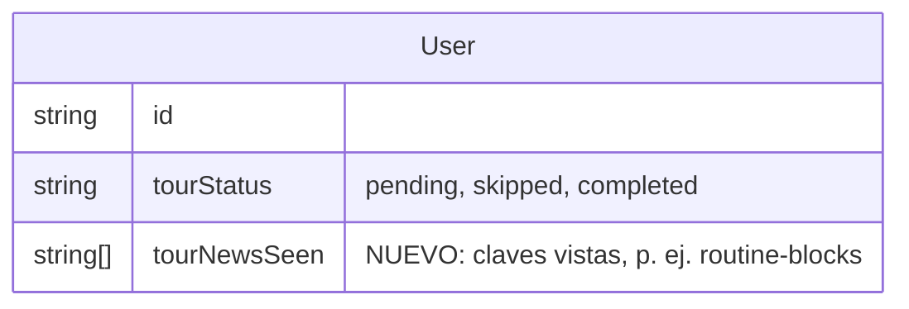

# Guía de novedades: rutinas por bloques (CYC-275, paso 4b)

> Contrastado con `origin/main`. Estado: propuesto. Maqueta en [`propuestas.html`](propuestas.html). Parte de la guía v3.1 (`docs/diseno/tour-primer-uso/`, componentes `components/tour/` y `lib/tourMarks.ts`) y del diseño `docs/diseno/sesion-por-bloques/`. Pedido de Desarrollo general; no hay tarjeta de diseño propia porque Linear no deja crear tarjetas, así que va sobre CYC-275.

## Qué es

Una guía corta de **cuatro marcas** que cuenta las novedades del constructor de rutinas. Usa el mismo lenguaje de las marcas de la guía: halo de 2 px en `#3080fc` con 4 px de separación (no bloquea clics) y globo `#1f2228` de hasta 280 px con flecha, «Novedad N de 4», una instrucción de **12 palabras o menos**, **Siguiente**, **Saltar paso** y **Salir**. Sin movimiento propio, sin atenuar la pantalla (los cajones ya traen su velo).

## Cuándo se muestra

| Quién | Cómo la ve |
|---|---|
| **Coach que ya vio la guía** (`tourStatus` completada o saltada) | Una **tarjeta en Biblioteca** la primera vez después de la actualización: «Tus rutinas ahora van por bloques», con **Verlo en 4 pasos** y **Ahora no**. Cualquiera de las dos la marca como vista y no vuelve a salir. |
| **Coach nueva** (guía pendiente o en curso) | Sin tarjeta. Las marcas de bloques entran dentro del paso 4 «Ejercicios» de su guía (tabla en la maqueta, sección 3). |
| **En cualquier momento** | «Cómo usar Cycles» tiene una sección **Novedades** con la fila «Rutinas por bloques», **Nuevo** y **Verlo de nuevo**. |

## Las cuatro marcas

Orden propuesto (dónde se crea, luego cómo se organiza):

| # | Elemento resaltado | Globo | Se completa cuando |
|---|---|---|---|
| 1 | **Nueva rutina** en Biblioteca (el cajón es el único lugar para crear y editar; ya no hay página aparte) | «Crear y editar rutinas ahora es en un solo cajón.» | Se abre el cajón o Siguiente |
| 2 | **Agregar bloque** del cajón | «Agrupa tu rutina en bloques: calentamiento, pliometría, fuerza.» | Hay ≥1 bloque o Siguiente |
| 3 | **Asa de arrastre** de un ejercicio | «Arrastra un ejercicio a otro bloque, o usa ⋯ y Mover.» (la alternativa por menú va en el propio globo) | Siguiente |
| 4 | **Agrupar en bloques** en una rutina antigua | «Tus rutinas anteriores siguen igual. Agrúpalas cuando quieras.» | Se pulsa o Siguiente |

- La **marca 4 solo aparece si existe al menos una rutina sin bloque**; si no, la guía tiene tres marcas («Novedad N de 3»).
- Si el cajón no está abierto, las marcas 2 y 3 abren una rutina de ejemplo **sin guardar** (o piden abrir el cajón con la ficha «Volver al paso N»), como ya hace la guía con los pasos de pantallas cerradas.
- Todas se pueden **saltar** una a una o **salir** de la guía; salir cuenta como vista.

## Qué se guarda

Un campo nuevo por cuenta, `tourNewsSeen` (lista de claves de novedades vistas; hoy solo `routine-blocks`), para que la tarjeta no reaparezca en otro dispositivo. La marca de «ya empezó» y los pasos saltados siguen en el navegador, como en la guía. Sin datos de salud ni de rendimiento (R1–R12 de `docs/SEGURIDAD.md`).

Cambio aditivo (columna con valor por defecto lista vacía); mostrar la tarjeta exige `tourStatus` distinto de `pending` y `routine-blocks` ausente de `tourNewsSeen`.

## Accesibilidad

- El globo es un diálogo no modal con foco en **Siguiente**; **Esc** sale de la guía. Cada marca anuncia «Novedad N de 4» y su instrucción.
- El arrastre tiene alternativa por menú (⋯, «Mover a otro bloque») y el globo la nombra.
- El halo no es el único indicador: el globo nombra el elemento; contraste del texto blanco sobre `#1f2228` 15,9:1.

## Preguntas para la usuaria

1. ¿La tarjeta de Biblioteca es la forma correcta de avisar a quien ya vio la guía, o prefieres que aparezca en Inicio?
2. ¿Dejamos fuera la marca de arrastre para quien use el menú, o siempre se muestra?
3. ¿El orden propuesto (cajón, bloques, arrastre, agrupar) te sirve?
