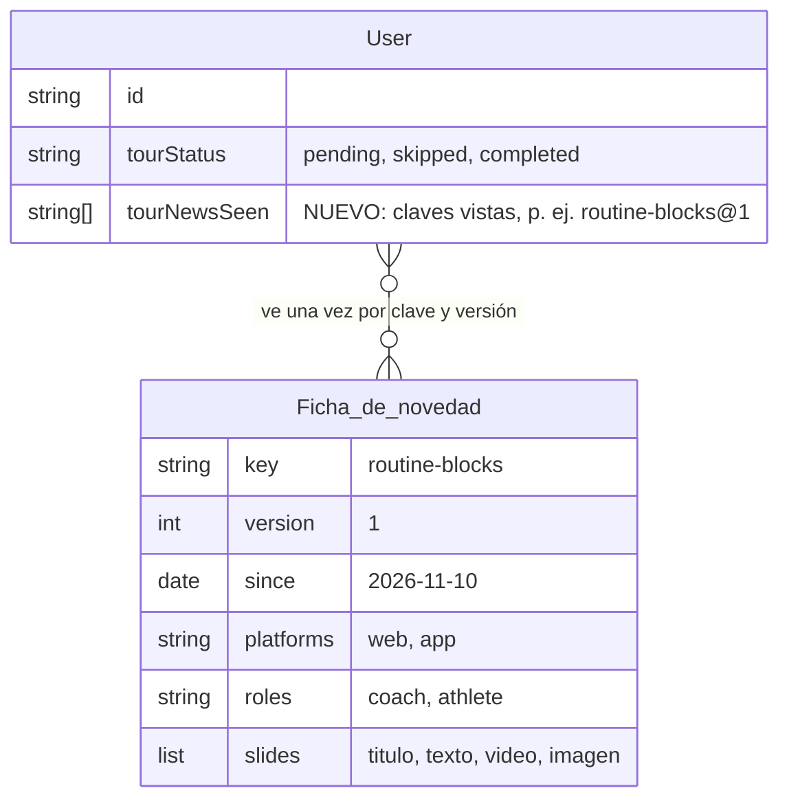

# Novedades de Cycles: un sistema permanente (CYC-275, paso 4b)

> Contrastado con `origin/main`. Estado: propuesto. Maqueta interactiva en [`propuestas.html`](propuestas.html) (el popup se abre, se cierra con Esc y atrapa el foco). Reemplaza la primera versión de este PR (cuatro marcas sobre la interfaz, como la guía de primer uso): la usuaria decidió que las novedades aparezcan **en el centro de la pantalla, con el fondo borroso, como un popup de un par de slides** con una animación de demostración y una explicación breve. Resuelve las tres preguntas anteriores (dónde avisar, arrastre, orden).

## Qué es

Cada vez que se entrega una funcionalidad nueva, se genera su **novedad**: un popup centrado con fondo borroso y de 2 a 4 slides. Cada slide trae una **demostración animada** (bucle de 6 a 8 segundos) y un texto corto, en tuteo y con tono cercano: «Te presentamos la nueva forma de agrupar tu entrenamiento». Se ve **una vez por novedad** y se reabre siempre desde «Cómo usar Cycles › Novedades».

## 1. El popup

- **Fondo borroso** (`backdrop-filter: blur(10px)` sobre un velo de tinta al 38 %). Tarjeta de 720 px (máximo 100 % menos 32 px), radio 20, demostración arriba (16:9 aprox., 292 px), etiqueta «Novedad», título de 1,5 rem, texto de ≤ 140 caracteres.
- **Controles:** **Saltar** (a la izquierda; en la última slide dice **Cerrar**), indicador de avance (puntos, el actual alargado, con texto accesible «Slide 2 de 4»), **Atrás** (desde la 2.ª) y **Siguiente** (en la última, **Entendido**). Cierre con la **X**, con **Esc** o tocando el fondo.
- **Accesibilidad:** `role="dialog"`, `aria-modal`, nombre y descripción por título y texto; **foco atrapado** (Tab y Mayús+Tab no salen; el foco inicial va en **Siguiente**) y devuelto al elemento que lo abrió; flechas ← → cambian de slide; la demostración lleva `role="img"` con su descripción. Contraste del texto ≥ 4,5:1; botones de 40 px o más.
- **Reducir movimiento:** con `prefers-reduced-motion`, la demostración **no se anima y muestra el resultado final** como imagen fija (la maqueta tiene un interruptor para verlo). Sin parpadeos ni autoavance: las slides solo cambian cuando la persona lo pide.
- **Responsive:** ver «Reactivo a la pantalla» más abajo; el popup responde al tamaño real de la ventana.

## Reactivo a la pantalla

Decisión de la usuaria: la guía debe ser reactiva a las dimensiones de la pantalla donde se abra. El popup se calcula con el tamaño **real** de la ventana (consultas de contenedor y unidades relativas, no una lista de modelos). La maqueta lo prueba con **ocho ventanas reales** (iframes con ese tamaño) y se verificó que la tarjeta y su pie con botones quedan siempre dentro de la pantalla.

| Tamaño de la ventana | Cómo responde |
|---|---|
| **760 px o más de ancho** | Tarjeta de 720 px centrada; demostración al 100 %; controles en una fila. |
| **480 a 759 px** | Ancho de la ventana menos 32 px; la demostración se escala con el ancho (nunca se recorta); controles en una fila. |
| **Menos de 480 px** | Margen de 16 px; título de 1,25 rem; puntos arriba; Atrás y Siguiente a ancho completo y Saltar como enlace; botones de 44 px o más. Ancho mínimo admitido: 320 px. |
| **Horizontal bajo** (alto ≤ 520 y ancho ≥ 560) | Demostración a la izquierda (46 %) y texto con controles a la derecha, sin desplazarse. |
| **Muy bajo** (alto ≤ 380 y ancho < 560) | Sin demostración (queda disponible en el historial); texto y controles. |
| **Letra grande** (×1,3, ×1,6, ×2) y zoom del navegador | Texto en rem; el cuerpo se desplaza dentro de la tarjeta y el **pie con botones siempre visible**; la tarjeta no supera el alto de la ventana menos 32 px; con zoom al 200 % se comporta como un teléfono. |
| **Áreas seguras y rotación** | `env(safe-area-inset-*)` para el notch y la barra inferior; al rotar o redimensionar se reacomoda sin perder la slide actual. |

Tamaños probados: escritorio 1440 × 900, tablet 768 × 1024, teléfono 390 × 844 (también con letra ×1,6), teléfono pequeño 320 × 568, teléfonos horizontales 844 × 390 y 667 × 375, y 360 × 360. En la app, estos mismos criterios aplican a los puntos de corte de la ventana nativa y a `useWindowDimensions()`.

## 2. Cuándo aparece y cómo se reabre

| Quién | Qué ve |
|---|---|
| **Usuaria que ya usa Cycles** | Al abrir la web o la app, si hay una novedad de su rol y plataforma sin ver, sale el popup (1,5 s después de cargar). Cerrar, saltar o llegar al final la marca como vista. |
| **Usuaria nueva** | Al crear la cuenta se marcan como vistas todas las novedades vigentes: lo que ya existe lo aprende con su **guía de primer uso**. Desde ahí ve las novedades futuras, y **nunca mientras la guía esté en curso**. |
| **Varias sin ver** | Solo la más reciente; las anteriores quedan en el historial. Sin popups encadenados. |
| **No se muestra** | Con un diálogo, cajón, formulario sin guardar o la guía de primer uso abiertos; ni a un rol o plataforma a los que no corresponde. |
| **Reabrir** | «Cómo usar Cycles» › pestaña **Novedades**: historial con fecha y **Ver de nuevo**. Volver a verla no cambia ningún estado. |

## 3. Primera novedad: bloques de trabajo (`routine-blocks@1`)

| # | Slide | Texto | Demostración |
|---|---|---|---|
| 1 | Te presentamos la nueva forma de agrupar tu entrenamiento | Arma la rutina por bloques: calentamiento, pliometría, fuerza y más. Cada bloque tiene su color y su ícono. | Una lista plana se ordena en tres bloques de colores. |
| 2 | Mueve los ejercicios entre bloques | Arrastra un ejercicio dentro de su bloque o a otro. ¿Prefieres no arrastrar? Usa ⋯ y Mover a otro bloque. | Un ejercicio se arrastra de Fuerza a Pliometría; la alternativa por menú queda a la vista. |
| 3 | Tus rutinas anteriores siguen igual | Cuando quieras, toca Agrupar en bloques y ordénalas. Solo sale si tienes rutinas sin bloque. | Se pulsa «Agrupar en bloques» y la rutina suelta se ordena. **Se omite si no hay rutinas sin bloque** (`when: hasUngroupedRoutines`). |
| 4 | Una página nueva para editar por bloques | Rutinas y sesiones se editan en la misma página, ordenadas por bloques. Toca Editar y pruébala. | Se pulsa «Editar» y entra la página, con los bloques. **Depende de que la usuaria confirme la página aislada de edición** (`when: blocksPageEnabled`); hasta entonces se omite. |

## 4. Cómo se define una novedad nueva (barato y sin tocar la lógica)

Una **ficha por funcionalidad** en un registro compartido, `packages/shared/src/novelties.ts`, que leen la web y la app:

```json
{
  "key": "routine-blocks", "version": 1, "since": "2026-11-10",
  "platforms": ["web"], "roles": ["coach"],
  "slides": [
    { "title": "…", "text": "…", "video": "novedades/routine-blocks-1.webm", "poster": "novedades/routine-blocks-1.png" },
    { "when": "hasUngroupedRoutines", "…": "…" }
  ]
}
```

- **Demostración:** un bucle corto grabado desde la **cuenta demo** (6 a 8 s, ≤ 500 KB, `webm` o `mp4`) más una **imagen fija** (`png`) para «reducir movimiento». Sin código de animación: grabar es lo único que cuesta.
- **Versión:** si una novedad mejora, sube `version`; la clave pasa a `…@2` y vuelve a mostrarse.
- **Condiciones** (`when`) opcionales, de una lista cerrada de funciones sin efectos secundarios.
- **Pruebas automáticas:** claves únicas, máximo 4 slides, textos de ≤ 140 caracteres y que existan el video y la imagen de cada slide.

**Regla para Desarrollo general y App móvil** (va en la lista de verificación de cada PR de funcionalidad, junto a los criterios de `PRD-General §10.1`):

| Cuándo | Qué se hace |
|---|---|
| Una tarjeta con un cambio que la usuaria nota | Se crea su ficha y se graban la demostración y la imagen fija, **en el mismo PR** que la funcionalidad. |
| Cambio interno o sin efecto visible | Sin ficha: se escribe «Sin novedad» y el motivo en el PR. |
| Mejora de una novedad ya publicada | Sube `version`. |
| Diseño | Entrega el texto y el guion de las slides si se pide en la tarjeta. |

## 5. Datos

Se reutiliza `tourNewsSeen` (lista de claves vistas) en `User`; la clave incluye la versión. Es una columna **aditiva** (lista vacía por defecto); al crear la cuenta se llena con las claves vigentes. La ficha no es una tabla: vive en el código.



Sin datos de salud ni de rendimiento (R1–R12 de `docs/SEGURIDAD.md`).

## 6. App móvil

Mismo sistema, en el centro de la pantalla: tarjeta con fondo borroso, demostración arriba y los mismos controles. Las novedades del atleta (por ejemplo, el calendario con eventos) usan su ficha con `roles: ["athlete"]` y `platforms: ["app"]`. Con letra grande el texto crece y la tarjeta se desplaza.

## Qué queda del diseño anterior

La guía de primer uso (`docs/diseno/tour-primer-uso/`) **no cambia**: sigue siendo el recorrido de la coach nueva. Las novedades son un sistema aparte que no depende de las marcas sobre la interfaz.
