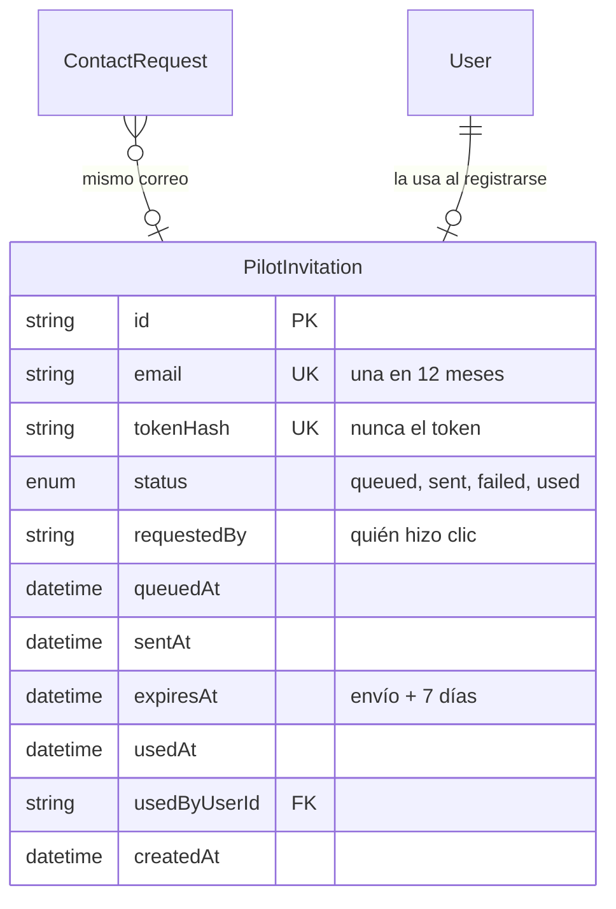

# Invitaciones en admin.getcycles.app (CYC-295)

Solo diseño. **Pendiente de aprobación de la usuaria.** Maqueta que se puede probar en [admin-invitaciones.html](admin-invitaciones.html); capturas `capturas/admin-*.png`. Usa los estilos actuales del portal (`apps/admin`).

## Pedido y decidido por la usuaria (26-11)

Lo respondió en el chat de Organización, que lo trasladó a diseño.

- La lista para aprobar a quién se le envía vive en admin.getcycles.app. Un botón junto a cada solicitud envía el correo oficial de invitación.
- A quienes escribieron antes no se les envía nada automático.
- Máximo 15 al día. Lo que supere el tope queda en cola y sale solo en los días siguientes.
- El registro de cada invitación se guarda hasta 12 meses, con una invitación por correo en ese plazo.

## El clic reemplaza el envío automático

**Confirmado por la usuaria (26-11, trasladado por Organización):** por ahora, todas las solicitudes esperan su clic en admin.

### Textos que cambian (los nuevos, pendientes de aprobación)

| Pieza | Aprobado antes | Propuesta nueva |
|---|---|---|
| Confirmación en la página | Recibido. Tu invitación a Cycles va a tu correo. Si no la ves, revisa el spam o escríbenos a hola@getcycles.app. | Recibido. Revisamos cada mensaje: si te damos acceso, la invitación llega a este correo. Si tienes dudas, escríbenos a hola@getcycles.app. |
| Aviso del formulario | Usaremos tu correo para enviarte tu invitación a Cycles y para responderte. Más en la política de privacidad. | Usaremos tu correo para responderte y, si te damos acceso, enviarte una invitación a Cycles. Más en la política de privacidad. |
| Regla 1 | Todos los que dejan su correo reciben la misma carta. | Todas las personas invitadas reciben la misma carta. |
| Regla 3 | Se envía automáticamente. | Se envía cuando el equipo hace clic en admin. |

No cambian el asunto, la vista previa, la carta, el botón, el aviso bajo el botón ni la pantalla del enlace que no sirve (ver la pregunta sobre vencidas). La maqueta [correo.html](correo.html) ya muestra la propuesta.

**Por revisar:** el texto que va sobre el formulario dice «cuéntanos cómo trabajas: te damos acceso». Con revisión, promete acceso a todas las personas. Propuesta: «cuéntanos cómo trabajas: revisamos cada mensaje para dar acceso». La maqueta lo muestra como está hoy.

## La pestaña

«Invitaciones», entre «Usuarios» y «Uso». El portal sigue abriendo en «Usuarios».

- **Una fila por correo**, aunque la persona haya escrito más de una vez: muestra el último mensaje y cuántas veces escribió. Así no se puede invitar dos veces desde la lista.
- No todos los mensajes piden acceso. Cada fila muestra el mensaje (dos líneas y «Ver todo») para decidir antes de invitar.
- Quien escribió antes de que cambie el aviso del formulario lleva la nota «Escribió antes del aviso nuevo».
- Filtros: «Por enviar» (incluye los errores), «En cola», «Invitadas» y «Todas». Lo más nuevo va arriba; los errores, al final de «Por enviar» en la maqueta.
- Arriba a la derecha: «Hoy salieron N de 15».
- Bajo 900 px las filas se apilan, como el resto del portal.

## Estados

| Estado | Qué dice | Botón |
|---|---|---|
| Sin invitar | | Enviar invitación, o **Poner en cola** si ya salieron las 15 |
| Enviando | Enviando | Desactivado |
| En cola | Sale desde mañana y su fecha | Quitar de la cola |
| Enviada | Fecha de envío y de vencimiento | Ninguno |
| Cuenta creada | Fecha en que usó la invitación | Ninguno |
| Vencida | Fecha de vencimiento | Ninguno (ver pregunta) |
| Error de envío | No salió el correo. | Reintentar |
| Ya tenía cuenta | Solo aparece en «Todas» | Ninguno |

## Reglas

1. **Confirmación en la fila** (propuesta de diseño): «¿Enviar la invitación a este correo?», «Sí, enviar» y «Cancelar». Suma un clic al pedido; evita enviar un correo por error, que no se puede deshacer. Es el mismo patrón que «Quitar» en la pestaña Correos.
2. **Cola:** sale en el orden en que se agregó, sin otro clic. El enlace vence 7 días después del envío, no del día en que entró a la cola. Quitar de la cola la devuelve a «Sin invitar» (propuesta).
3. **Tope:** 15 envíos por día. Desarrollo define la zona horaria y a qué hora sale la cola; la fecha que se muestra debe coincidir. Un envío con error no descuenta cupo (propuesta).
4. **Error:** reintentar no cuenta como segunda invitación, porque la primera no salió. Si falla algo que estaba en cola, pasa a «Error de envío» y no se reintenta solo.
5. **Cupo y doble clic:** el servidor decide si envía o encola; dos clics o dos sesiones no pueden crear dos envíos.
6. **12 meses:** pasado el plazo se borra el registro y ese correo podría volver a invitarse.
7. **Registro de consultas:** ver la lista, enviar, encolar y quitar de la cola quedan registrados, como las demás vistas del portal.

Fuera de este diseño: descartar u ocultar mensajes que no piden acceso, enviar varias a la vez y los rebotes posteriores al envío.

## Pregunta: invitaciones vencidas

Con «una invitación por correo en 12 meses», una persona con la invitación vencida queda **sin salida** durante ese plazo, aunque la pantalla del enlace le dice «escríbenos y te ayudamos».

**Propuesta:** permitir «Enviar de nuevo» solo en las vencidas. Renueva la misma invitación (enlace nuevo, el anterior deja de servir), usa cupo y no crea un segundo registro. La maqueta sigue la regla actual y no muestra ese botón hasta que se decida.

## Base de datos

Cambia el modelo propuesto por Desarrollo general: la invitación nace con el clic y suma la cola y quién la envió. Conceptual; los nombres los define desarrollo. Antes de migrar: diagrama final, respaldo y «apruebo» de la usuaria.

«Sin invitar» no se guarda: es un correo de `ContactRequest` sin invitación. «Vencida» se calcula con `expiresAt`. «Ya tenía cuenta» se calcula con `User`. El token del enlace se genera al enviar, no al encolar.

## Privacidad

Además de lo anotado en [README.md](README.md): `/privacidad` debe decir que el equipo revisa el mensaje para decidir a quién invita. El registro de la invitación se borra a los 12 meses.

## Novedad

No lleva ficha: es el portal interno.
