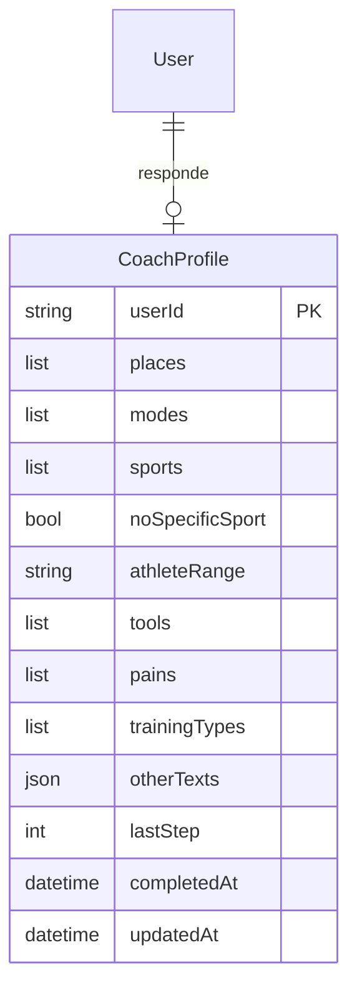

# Registro por pasos con perfil del coach (CYC-295)

**Aprobado por la usuaria (26-11)**, con las siete preguntas, los emojis y las transiciones. Solo diseño. Maqueta que se puede recorrer en [registro.html](registro.html); capturas `capturas/registro-*.png`.

## Para qué

Saber quién va a usar Cycles y cómo trabaja antes de usarlo. Sirve para agrupar coaches, ofrecerles más adelante lo que les sirva, adaptar la app y preparar mejor las reuniones.

## Pedido por la usuaria (26-11)

- Formato de las novedades y una barra de avance en % que sube con cada pregunta.
- Preguntas sobre dónde entrena, cómo entrena y qué deportes hacen sus deportistas.
- Dos o más preguntas extra para agrupar a los coaches.

## Preguntas

Las preguntas de personas, planificación y dificultad las propuso diseño. La del tipo de entrenamiento la pidió la usuaria como última; sus opciones son propuesta.

| % | Pregunta | Opciones | Para qué se usa |
|---|---|---|---|
| 13 | ¿Dónde entrenas? (varias) | Gimnasio, Online, Cancha, Otro | Contexto de trabajo |
| 25 | ¿Cómo entrenas? (varias) | 1:1, Grupos, Equipos, Otro | Saber a quién le sirven Equipos y el ciclo del equipo |
| 38 | ¿Qué deportes hacen tus deportistas? Elige todos los que conozcas (varias, con buscador) | 22 deportes, cada uno con su emoji, Otro deporte, No hacen un deporte específico (excluye al resto) | Ejercicios, ejemplos y ofertas por deporte |
| 50 | ¿A cuántas personas entrenas hoy? (una) | Todavía a ninguna, 1 a 5, 6 a 15, 16 a 40, Más de 40 | Tamaño; qué plan podría servirle |
| 63 | ¿Con qué planificas y haces seguimiento hoy? (varias) | Excel o Google Sheets, Papel o cuaderno, WhatsApp u otros mensajes, Otra app de entrenamiento, Todavía no llevo registro (excluye al resto), Otro | Desde qué hábito viene; qué importar o reemplazar |
| 75 | ¿Qué es lo que más te cuesta hoy? Elige hasta dos | Armar los planes, Ajustar según cómo responde cada persona, Saber quién entrenó y cómo le fue, Organizar a muchas personas o equipos, Mostrarles su avance, Otro | Abrir una reunión por su problema real; priorizar producto |
| 88 | ¿Qué tipo de entrenamiento haces? Elige todos los que apliquen | Fuerza, Hipertrofia, Potencia y saltos, Velocidad y agilidad, Resistencia, Funcional, Técnico y táctico, Movilidad, Readaptación y prevención, Acondicionamiento general, Otro | Ejemplos, ejercicios y ofertas según su forma de entrenar |

## Recorrido y reglas

1. **Cuenta (0 %).** Rol (coach marcado), correo fijo, nombre, contraseña y casillas actuales. La cuenta se crea aquí: si la persona abandona las preguntas, no se pierde.
2. **Preguntas.** Una por paso. «Siguiente» se activa al responder; «Atrás» conserva lo elegido. Cada respuesta se guarda al avanzar, y al volver a entrar se retoma donde quedó.
3. **Final (100 %).** «Tu cuenta está lista» y «Entrar a Cycles»; sigue la tarjeta «Así se arma un ciclo».
4. El % es la parte completada: cuenta y siete preguntas, ocho pasos.
5. **Atleta:** después de la cuenta pasa directo al final. No responde preguntas (su onboarding sigue postergado). Los campos de teléfono que ya existen van en su paso de cuenta y no aparecen en la maqueta.
6. Las preguntas son obligatorias, sin «Saltar». Esto es una excepción al principio «se puede saltar y volver» de PRD-Onboarding, que habrá que actualizar.

## Formato

Tarjeta centrada de 648 px sobre fondo borroso, con escenario arriba, texto abajo y «Atrás» y «Siguiente», como las novedades. Cambia respecto de ellas: barra de avance en lugar de puntos, sin «×», radios de 6 y 8 px. El escenario muestra «Tu perfil de coach», que se llena con cada respuesta. En el teléfono muestra solo las filas respondidas y la actual. Con «reducir movimiento» no hay animaciones.

## Emojis de deportes

🏐 Vóleibol, ⚽ Fútbol, 🥅 Futsal, 🏀 Básquetbol, 🤾 Handball, 🏉 Rugby, 🏑 Hockey, 🏊 Natación, 🏃 Atletismo, 👟 Running, 🚴 Ciclismo, ⏱️ Triatlón, 🎾 Tenis, 🏓 Pádel, 🥋 Karate, Judo y Taekwondo, 🥊 Boxeo, 🤸 Gimnasia, 🏋️ Halterofilia, 💪 Powerlifting, 🧗 Escalada, ➕ Otro deporte.

No hay emoji propio de futsal, running, triatlón, pádel ni powerlifting: se usa el más cercano. Las tres artes marciales comparten uno. Cada dispositivo los dibuja a su manera. Se ocultan a los lectores de pantalla. «Entrenamiento funcional» salió de los deportes porque está en la pregunta de tipo de entrenamiento. El buscador debe aceptar variantes como «voley».

## Transiciones

| Momento | Qué se mueve |
|---|---|
| Avanzar | La pregunta sale hacia la izquierda (0,19 s) y entra la siguiente desde la derecha (0,3 s). Las opciones aparecen en cascada. |
| Atrás | Igual, en sentido contrario. |
| Barra | Se llena en 0,5 s y el número cuenta hasta el nuevo %. |
| Tarjeta | Ajusta su alto sin saltos. |
| De la cuenta a las preguntas | El logo da paso al perfil. |
| Elegir una opción | La opción late, el emoji salta y la etiqueta sube al perfil. |
| Final | Las etiquetas del perfil se destacan una tras otra y entra el mensaje. |

Durante la transición no se puede avanzar dos veces. Con «reducir movimiento» el cambio es inmediato.

## Privacidad

- Sin datos de salud. Los campos «Otro» son cortos (60 caracteres) y opcionales. No hay respuestas de texto libre largas.
- En la primera pregunta se avisa: «Con estas respuestas adaptamos Cycles a tu forma de entrenar, te ofrecemos lo que te sirva y preparamos mejor nuestras conversaciones contigo.»
- Antes de construir hay que sumar a `/privacidad` qué se guarda, para qué (incluye ofertas y reuniones), cuánto tiempo, y que sale en la exportación y se borra con la cuenta.
- **No revisado legalmente:** si enviar ofertas por correo requiere una casilla aparte y una forma de darse de baja.
- No enviar las respuestas a la analítica sin decidirlo antes.

## Base de datos

Requiere un cambio en la base. Modelo conceptual; los nombres los define desarrollo. Antes de migrar: diagrama final, respaldo y «apruebo» de la usuaria.

## Por decidir

- Qué ven los coaches que ya tienen cuenta (propuesta: nada por ahora).
- Dónde consulta el equipo las respuestas (el portal interno no está diseñado para esto).
- Si el coach puede ver o cambiar sus respuestas después.

## Novedad

No lleva ficha: es parte de crear la cuenta.
