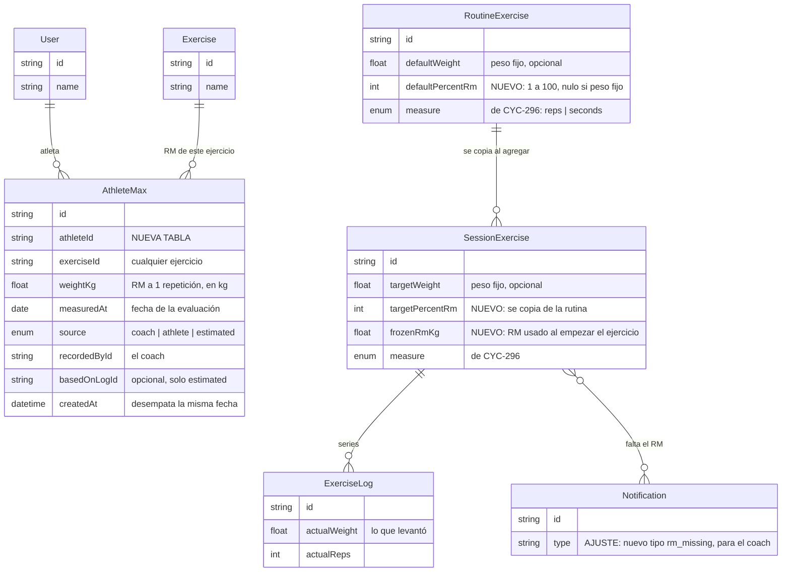
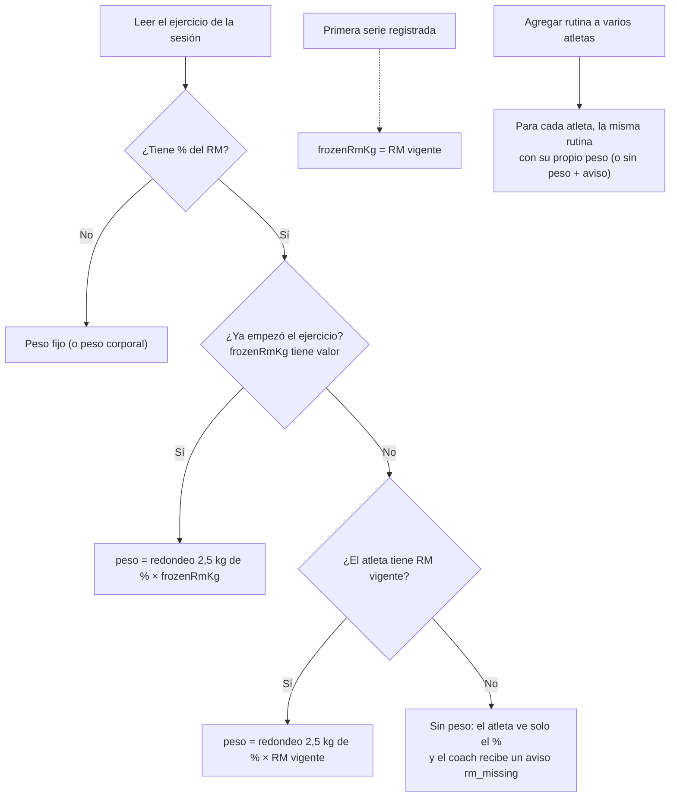

# RM del atleta por ejercicio y carga como % del RM (CYC-305)

> Contrastado con `origin/main` (2026-11-20). Estado: **propuesto**; el modelo de datos ya fue aprobado por la usuaria (CYC-306) y ella respondió las preguntas del diseño (abajo). Sin cambios de código. Maquetas en [`propuestas.html`](propuestas.html); capturas en `capturas/`. Origen: un coach nuevo del piloto, con un equipo de voleibol, pidió registrar el RM de cada atleta por ejercicio y planificar la carga como % del RM. Tarjeta hermana de API: CYC-306 (Desarrollo general).

## Reglas de la usuaria

1. **El RM es el peso máximo a 1 repetición**, y **todos los ejercicios pueden tener RM** (también los de peso corporal y los medidos por tiempo).
2. **Solo el coach registra el RM.** El atleta no lo escribe: en la app solo ve, como comentario, que está levantando el x % de su RM, si lo tiene calculado.
3. **Lo levantado en las series no es el RM.** Se muestra aparte como «máximo levantado» (peso × repeticiones), de referencia. El coach puede **calcular un RM aproximado** a partir de un peso y unas repeticiones que él elige; nunca se convierte solo.
4. **El RM cambia con el tiempo**, según las evaluaciones del coach: cada evaluación agrega un registro con su fecha.
5. **Una rutina se piensa para una persona o para un equipo.** El % es el mismo para todos y cada atleta recibe su peso según su RM.
6. **Si el plan usa % y al atleta le falta el RM**, no se bloquea: se deja un aviso al coach para que agregue el RM o calcule uno aproximado.
7. **Redondeo a 2,5 kg**, y se informa que es para que calce con los discos.
8. El aviso al atleta cuando cambia su RM es una **victoria o trofeo**: se diseña después, fuera de esta tarjeta.

## Qué hay hoy

- La carga es un peso fijo y opcional: `RoutineExercise.defaultWeight`, `SessionExercise.targetWeight`, `ExerciseLog.actualWeight` (siempre en kg; nulo = peso corporal). No existe RM ni carga relativa.
- Una rutina es del coach, no de un atleta. Al agregarla a una celda de un ciclo, sus filas se **copian** a `SessionExercise`, que sí pertenece al ciclo de un atleta ([`sessions.service.ts`](../../../apps/api/src/sessions/sessions.service.ts) línea 92).
- Un ciclo de la Biblioteca se asigna **a un atleta a la vez** y solo copia el ciclo **vacío** (`cycles.service.ts`, `assign`). El % vive en las **rutinas** y en las **sesiones de un atleta**, no en el ciclo plantilla.
- **No existe el equipo** como grupo con nombre: un equipo son varios atletas del coach.
- La fila del constructor tiene Ser., Reps, Carga, Desc. y RIR ([`ExerciseRowEditor.tsx`](../../../apps/web/src/components/builder/ExerciseRowEditor.tsx)). La app prellena el peso con `targetWeight` y muestra «4 × 6 · 60 kg» en Hoy.
- La propuesta de CYC-296 (ejercicios por tiempo, PR #257) sigue abierta: aquí se diseña para que ambas convivan.

## Decisiones del diseño

| # | Tema | Decisión |
|---|---|---|
| 1 | Quién registra el RM | Solo el coach, desde la ficha del atleta (sección RM) o desde el constructor. El atleta no lo escribe ni tiene pantalla «Mis RM». |
| 2 | Qué ve el atleta | Un comentario: «Estás levantando el 80 % de tu RM», con el peso calculado y la nota «Peso redondeado a 2,5 kg para que calce con los discos». Sin RM calculado: «Aún no hay peso calculado» y registra el peso que use. |
| 3 | Constructor de rutina | La celda de Carga lleva el selector «kg / % RM» (mismo patrón que «reps / tiempo» de CYC-296). Hay una vista previa opcional con el RM de un atleta, que agrega la columna «Peso de Valentina». Si a esa persona le falta el RM, la fila dice «Sin RM» y el % **sigue disponible** (la rutina es para todos). |
| 4 | Sesión de una persona | Al editar la sesión de un atleta, «% del RM» se desactiva donde no tiene RM, con la razón y dos salidas: «Ingresar el RM de Valentina» y «Calcular un RM aproximado». |
| 5 | Agregar la rutina a varios atletas | Se eligen los atletas (o «Todos mis atletas») y una tabla muestra el peso de cada uno por ejercicio. A quien le falta RM se le **agrega igual**, con el % sin peso, y se avisa al coach. |
| 6 | Aviso al coach | Un aviso por atleta: «Camila Rojas no tiene RM en Peso muerto ni en Hip thrust», con «Agregar RM» y «Calcular aproximado». Sin datos de salud. Desaparece al registrar el RM. |
| 7 | RM aproximado | Calculadora del coach (fórmula de Epley: peso × (1 + reps ÷ 30)), con «Usar el máximo levantado» como atajo editable. El resultado queda con origen **Aproximado** hasta que una evaluación lo reemplace. |
| 8 | Evaluaciones | Cada RM lleva su «fecha de la evaluación». «Actualizar» agrega un registro y el anterior queda en el **historial** del ejercicio. |
| 9 | Si cambia el RM después de asignar | El peso es **vivo** mientras el ejercicio no se haya empezado: usa el RM vigente. Al registrar la primera serie se **congela** el RM usado. Lo ya registrado no cambia. |
| 10 | Ejercicio por tiempo | La carga admite «% del RM» igual que una fila por repeticiones. RIR sigue apagado (CYC-296). |

## Qué se ve en cada lugar

| Lugar | Con RM | Sin RM |
|---|---|---|
| Constructor de rutina, con un atleta en la vista previa | `80 % RM ⌄` y «72,5 kg» | «Sin RM»; el % sigue disponible |
| Sesión de una persona (web) | `80 % RM` y «72,5 kg» | «% del RM» desactivado; «Ingresar el RM» o «Calcular un RM aproximado» |
| Agregar rutina a varios atletas | «72,5 kg» por ejercicio, estado «Lista» | «Sin RM», estado «Falta RM»; se agrega igual y se avisa |
| Hoy (app y web) | `4 × 6 · 72,5 kg` | `3 × 10 · 75 % de tu RM` |
| Registro de la serie | Meta «6 × 72,5 kg», «Estás levantando el 80 % de tu RM», nota del redondeo, peso prellenado | «Aún no hay peso calculado», peso en 0 |
| Serie guardada | `6 reps · 72,5 kg` | Lo que registró el atleta |
| Ficha del atleta (web) | Tabla «Con RM»: RM, fecha de evaluación, origen y máximo levantado | Tabla «Sin RM» con «Agregar RM» |
| Aviso al coach | — | «Camila Rojas no tiene RM en…» |

Las pantallas cuidan la regla de no poner líneas grises bajo los títulos: el contexto va en columnas, etiquetas o el propio dato. No hay pantallas de Resumen.

## Cambio de modelo (diagrama)

Nombres acordados con Desarrollo general (CYC-306). Lo que cambia respecto de la propuesta anterior está marcado «AJUSTE».

Reglas del modelo:

- **Peso fijo o %, no ambos** (CHECK en la base y validación en la API).
- **AJUSTE: `source = estimated` se construye.** Es siempre una decisión del coach (calculadora con sus datos); `basedOnLogId` es opcional. Nada lo crea solo.
- **AJUSTE: cualquier ejercicio puede tener RM y llevar %.** Sin restringir por peso corporal ni por `measure`.
- **AJUSTE: agregar una rutina con % a un atleta sin RM no se bloquea.** Se crea la sesión con el % y sin peso (`rmStatus = missing`), y se genera un aviso `rm_missing` para el coach. Guardar un % directamente en un ejercicio de la sesión de un atleta sin RM sí se rechaza (la pantalla lo desactiva).
- **`AthleteMax` es solo-agregar.** El RM vigente es el de `measuredAt` más reciente (empate: `createdAt`). Un error se corrige con otro registro. Cada evaluación agrega una fila: eso es el historial.
- **Escritura solo del coach** (control R5 coach–atleta). El atleta lee solo lo necesario para ver su %.
- **El peso no se guarda: se calcula al leer**, con redondeo a 2,5 kg (5 lb si usa libras). Contrato: por ejercicio, `targetPercentRm`, `resolvedWeightKg` y `rmStatus` = `ok` | `missing` | `needs_athlete`; a nivel de sesión, `exercisesMissingRm`.
- **«Máximo levantado»** sale de `ExerciseLog` (series vigentes): el mayor peso con sus repeticiones y fecha. Solo se lee.

Cómo se resuelve el peso que ve el atleta:

## Para Desarrollo general y las tarjetas que salen de este diseño

CYC-306 (PR #259) se construyó antes de estas respuestas. Lo que cambia:

| # | Trabajo | Estado frente al PR #259 |
|---|---|---|
| 1 | Agregar rutina con % a un atleta sin RM: **crear la sesión igual**, sin peso, con aviso `rm_missing` al coach (hoy devuelve 422 y no la crea) | Cambia |
| 2 | Guardar un % directo en la sesión de un atleta sin RM: sigue rechazado | Igual |
| 3 | `source = estimated` habilitado en `POST /athletes/:id/rm` (lo envía el coach; el cálculo de Epley lo hace la pantalla) | Cambia: estaba reservado |
| 4 | Quitar cualquier restricción por peso corporal o por `measure` para RM y % | Cambia |
| 5 | Agregar la misma rutina a varios atletas: una llamada por atleta o un endpoint por lote, con resultado por atleta | Nuevo |
| 6 | Aviso `rm_missing` (nuevo tipo de notificación para el coach, sin datos de salud) y que se cierre al registrar el RM | Nuevo |
| 7 | Atleta: `GET /me/rm` ya no es necesario para la pantalla; basta `targetPercentRm` y `rmStatus` | Sin pantalla «Mis RM» |
| 8 | Constructor web: selector «kg / % RM», vista previa, «Sin RM», desactivado en la sesión de una persona | Web |
| 9 | Ficha del atleta: sección RM, calculadora aproximada, historial, máximo levantado | Web |
| 10 | Pantalla «Agregar a varios atletas» y aviso al coach | Web |
| 11 | App del atleta: comentario «Estás levantando el x % de tu RM», nota de redondeo, estado sin peso | App |
| 12 | Helper compartido: «72,5 kg», «80 % de tu RM», nota del redondeo | `packages/shared` |
| 13 | Fichas de novedad | ver abajo |
| 14 | Política de privacidad: dato de rendimiento (no de salud); borrado de cuenta | PRD-PrivacidadYTerminos |
| 15 | Cobertura por rutina (atletas × ejercicios con %): tarjeta aparte (CYC-307), ahora cubierta en parte por la pantalla de varios atletas | CYC-307 |

## Fichas de novedad (popup)

Dos fichas: cada rol la ve en su plataforma. Textos de hasta 140 caracteres (miden 68, 91, 72 y 108).

- `coach-rm-percent@1` (web, coach), 3 slides:
  1. «Carga como % del RM»: «Elige % del RM en cada fila y Cycles calcula el peso de cada atleta.» Demo `rm-percent-row`.
  2. «El RM de cada atleta»: «Regístralo en su ficha con la fecha de evaluación. Si no lo tienes, calcula uno aproximado.» Demo `rm-athlete-sheet`.
  3. «Una rutina para varios atletas»: «Cada uno recibe su peso según su RM. Si a alguien le falta, te avisamos.» Demo `rm-multi-add`.
- `athlete-rm-percent@1` (app y web, atleta), 1 slide: «Tu peso, calculado»: «Tu coach puede indicar un % de tu RM. Verás el peso ya calculado y redondeado para que calce con los discos.» Demo `athlete-rm-percent`.

No hace falta un tour nuevo.

## Accesibilidad

- «Sin RM», «Falta RM», «Lista» y los orígenes (Coach, Aproximado) van en texto, no solo en color.
- Una opción desactivada del selector sigue siendo enfocable con el teclado y anuncia su razón («Valentina no tiene RM en Hip thrust»).
- Los campos de RM, peso y repeticiones aceptan teclado numérico; en la app los pasos miden 56 pt.
- «72,5 kg» usa coma decimal, como el resto de la app.

## Fuera de alcance

- El **equipo como entidad** (grupo con nombre). Hoy se elige a los atletas o a «Todos mis atletas»; un equipo con nombre sería un cambio de modelo aparte, con su diagrama.
- El aviso al atleta cuando cambia su RM (victoria o trofeo, se diseña después).
- Ver o editar el RM desde la app del coach (CYC-294 es solo lectura por ahora).
- Gráficos de evolución del RM.

## Respuestas de la usuaria (20-11)

1. Solo el coach registra el RM; el atleta solo ve el x % como comentario.
2. Redondeo sí, informando que es para que calce con los discos.
3. La rutina es para una persona o un equipo: el % se ajusta a cada atleta.
4. Plan con % y atleta sin RM: solo un aviso para que el coach agregue o calcule un RM aproximado.
5. El RM se modifica con el tiempo según las evaluaciones del coach.
6. Máximo levantado de referencia: sí.
7. Avisar al atleta cuando cambia su RM: sí, se gestionará después como victoria o trofeo.
8. Todos los ejercicios pueden tener RM.

## Preguntas que quedan

1. **Una contradicción para confirmar:** antes dijo que «% del RM» se desactiva donde el atleta no tiene RM; ahora, que con un plan hecho con RM solo se avisa. El diseño hace las dos cosas por separado: en la **sesión de una persona** se desactiva (con salidas: ingresar o calcular), y al **agregar una rutina** se mantiene el % y se avisa. ¿Está bien así?
2. ¿Hace falta el **equipo como grupo con nombre** (por ejemplo «Voleibol») para agregar la rutina de una vez, o basta con elegir atletas y «Todos mis atletas»?
3. ¿El «RM aproximado» usa la fórmula de Epley (peso × (1 + reps ÷ 30)) u otra que prefiera el coach?
