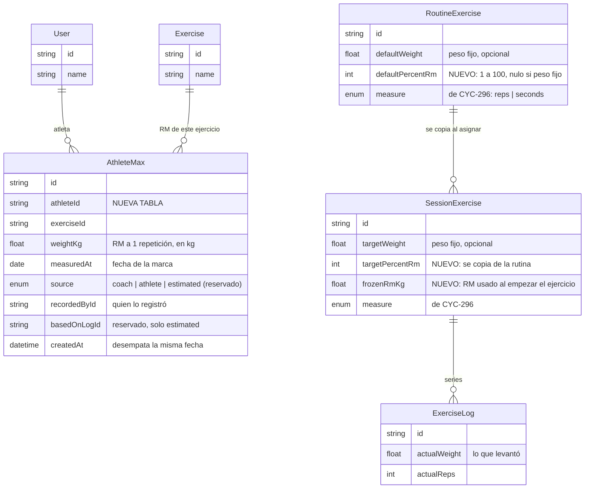
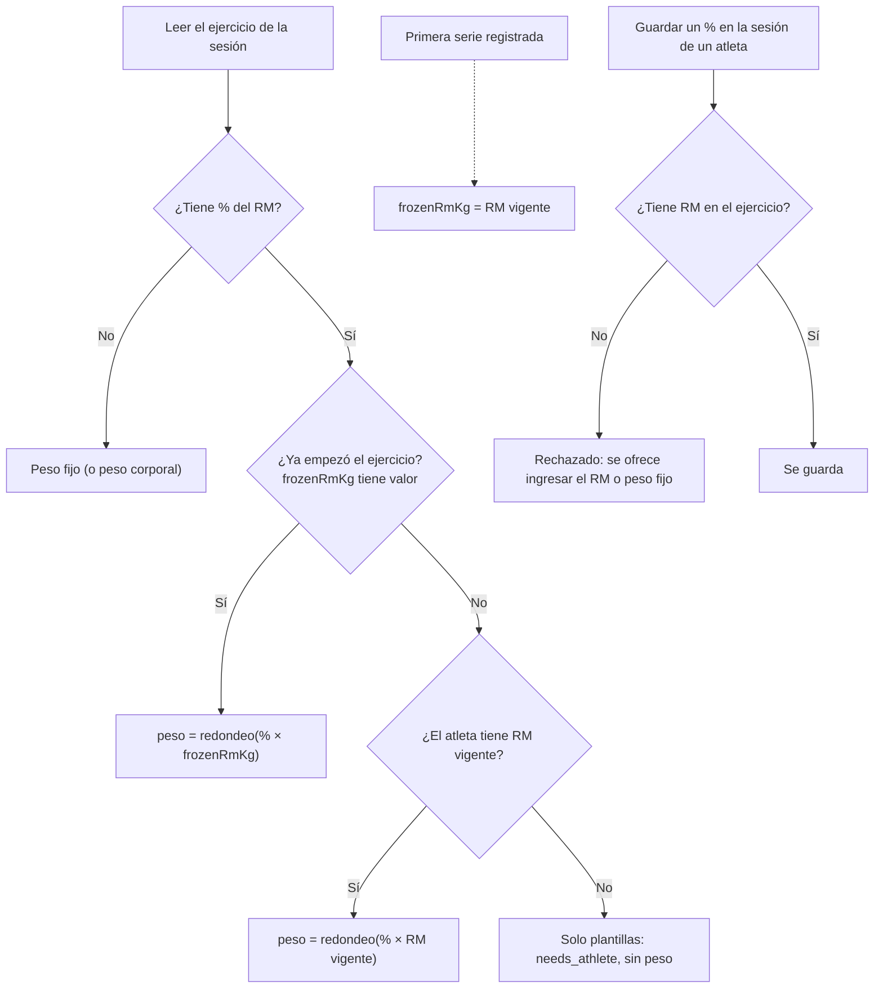

# RM del atleta por ejercicio y carga como % del RM (CYC-305)

> Contrastado con `origin/main` (2026-11-20). Estado: **propuesto**; el modelo de datos ya fue aprobado por la usuaria (ver CYC-306) y quedan dos decisiones abiertas. Sin cambios de código. Maquetas en [`propuestas.html`](propuestas.html); capturas en `capturas/`. Origen: un coach nuevo del piloto, con un equipo de voleibol, pidió registrar el RM de cada atleta por ejercicio y planificar la carga como % del RM. Tarjeta hermana de API: CYC-306 (Desarrollo general).

## Reglas ya decididas por la usuaria (20-11)

1. **El RM es el peso máximo a 1 repetición.**
2. **Sin RM, no hay % del RM.** Si el atleta no tiene RM en un ejercicio, la opción «% del RM» se desactiva para ese ejercicio: no se ofrece ni se puede guardar.
3. **Lo levantado en las series no es el RM.** Puede mostrarse como «máximo levantado» (peso × repeticiones), aparte y solo de referencia; nunca llena el RM ni se convierte solo. `estimated` queda reservado en el modelo, sin construir.
4. Modelo aprobado: tabla `AthleteMax`, % de 1 a 100, `frozenRmKg`. Redondeo a 2,5 kg por defecto (sin confirmar).

## Qué hay hoy

- La carga es un peso fijo y opcional: `RoutineExercise.defaultWeight`, `SessionExercise.targetWeight`, `ExerciseLog.actualWeight` (siempre en kg; nulo = peso corporal). No existe RM ni carga relativa.
- Una rutina es del coach, no de un atleta. Al asignarla a una celda de un ciclo, sus filas se **copian** a `SessionExercise`, que sí pertenece al ciclo de un atleta ([`sessions.service.ts`](../../../apps/api/src/sessions/sessions.service.ts) línea 92).
- Hoy un ciclo de la Biblioteca se asigna **a un atleta a la vez** y solo copia el ciclo **vacío** (`cycles.service.ts`, `assign`): las sesiones se arman después, agregando una rutina a una celda de la sesión de ese atleta. Por eso el % vive en las **rutinas** y en las **sesiones de un atleta**, no en el ciclo plantilla. «Varios atletas» significa la misma rutina agregada a la sesión de cada uno, y cada uno recibe su propio peso. No se agrega asignación masiva.
- La fila del constructor tiene Ser., Reps, Carga, Desc. y RIR ([`ExerciseRowEditor.tsx`](../../../apps/web/src/components/builder/ExerciseRowEditor.tsx)). La app prellena el peso con `targetWeight` y muestra «4 × 6 · 60 kg» en Hoy.
- Los ejercicios de peso corporal (`isBodyweight`) no llevan carga.
- La propuesta de CYC-296 (ejercicios por tiempo, PR #257) sigue abierta: aquí se diseña para que ambas convivan.

## Decisiones propuestas

| # | Tema | Recomendación | Alternativa |
|---|---|---|---|
| 1 | Constructor con un atleta en la vista previa | **A.** La celda de Carga lleva el selector «kg / % RM» (mismo patrón que «reps / tiempo» de CYC-296). Con un atleta elegido, aparece la columna «Peso de Valentina» y **«% del RM» queda desactivado** en los ejercicios donde no tiene RM, con la razón y la salida: «Ingresar el RM de Valentina». | Sin vista previa del atleta (menos claro). |
| 2 | Rutinas y ciclos plantilla (sin atleta) | **«% del RM» se ofrece en cualquier ejercicio con carga**, sin peso calculado. La comprobación pasa al agregar la rutina a la sesión de cada atleta. | Exigir un atleta de referencia para poder usar %: frena al coach que arma una plantilla para varios. |
| 3 | Agregar una rutina a la sesión de un atleta que no tiene todos los RM | **«Agregar» se desactiva** hasta resolver cada ejercicio con %: ingresar el RM (se abre su ficha) o **usar peso fijo** en esos ejercicios, con su kg. La API responde 422 con la lista y acepta `fixedWeights`. Asignar el ciclo plantilla no copia sesiones: no hay nada que comprobar ahí. | Agregar la rutina sin el % (la sesión queda sin carga en esos ejercicios). |
| 4 | Ejercicio por tiempo | La carga queda en **kg**; «% del RM» se apaga. | Permitir % en tiempo (no tiene sentido). |
| 5 | Quién registra el RM | **Coach siempre**, desde la ficha del atleta (sección RM) o desde el constructor. **Decisión abierta: ¿el atleta también?** Opción A: sí, desde Cuenta › Mis RM, con origen «Atleta» visible para el coach. Opción B: solo el coach; el atleta ve una lista de solo lectura. | — |
| 6 | Cómo se actualiza | Cada cambio es un **registro nuevo**; el vigente es el más reciente y el anterior queda en el historial, como las series. | Un solo valor editable (se pierde el historial). |
| 7 | Máximo levantado | Se muestra **aparte** y solo de referencia: en la ficha (columna «Máximo levantado», p. ej. «60 kg × 10») y en el formulario de RM («Es solo una referencia»). El campo de RM nunca se prellena con él. | No mostrarlo. |
| 8 | Si cambia el RM después de asignar | El peso es **vivo** mientras el ejercicio no se haya empezado: usa el RM vigente. Al registrar la primera serie se **congela** el RM usado. Lo ya registrado no cambia. | Foto al asignar y botón «Recalcular». |
| 9 | Redondeo | Al **2,5 kg** más cercano (5 lb si el atleta usa libras): 80 % de 90 kg = 72 → 72,5 kg. | Sin redondeo, o 1 kg o 5 kg. |
| 10 | Ejercicios con RM | Solo los que se cargan: ni peso corporal ni los medidos por tiempo. | Cualquiera. |

## Qué se ve en cada lugar

| Lugar | Con RM | Sin RM |
|---|---|---|
| Constructor, con un atleta en la vista previa | `80 % RM ⌄` y «72,5 kg» | «% del RM» desactivado con la razón; peso fijo; «Ingresar el RM de…» |
| Constructor, rutina o plantilla sin atleta | `80 % RM ⌄`, sin peso | No aplica: no hay atleta |
| Agregar una rutina a una celda de su sesión | Se agrega con % | «Agregar» desactivado hasta ingresar su RM o poner peso fijo |
| Hoy (app y web) | `4 × 6 · 72,5 kg` | El ejercicio llega con peso fijo (no puede llegar un % sin RM) |
| Registro de la serie | Meta «6 × 72,5 kg», chip «80 % de tu RM de 90 kg», peso prellenado | Como hoy, con el peso fijo |
| Serie guardada | `6 reps · 72,5 kg` | Lo que registró el atleta |
| Ficha del atleta (web) | Tabla «Con RM»: RM, fecha, origen y máximo levantado | Tabla «Sin RM» con «Agregar RM» |
| Rutina en la Biblioteca (web) | Matriz atletas activos × ejercicios con %: «72,5 kg» | «Sin RM» |
| Cuenta › Mis RM (app) | Lista con origen y fecha; opción A suma «Agregar RM» | Opción B: solo lectura |

Las pantallas nuevas cuidan la regla de no poner líneas grises bajo los títulos: el contexto va en columnas, etiquetas o el propio dato. No hay pantallas de Resumen.

## Cambio de modelo (diagrama)

Aditivo: una tabla nueva y columnas nulas. No toca datos existentes. Nombres acordados con Desarrollo general (CYC-306).

Reglas del modelo:

- **Peso fijo o %, no ambos** (CHECK en la base y validación en la API).
- **Sin RM no se guarda un %.** En un `SessionExercise` (que ya tiene atleta), la API rechaza `targetPercentRm` si el atleta no tiene RM en ese ejercicio. En una rutina o ciclo plantilla (sin atleta) sí se guarda, y la respuesta lleva `rmStatus = needs_athlete`.
- **Al agregar una rutina a una celda**, si el atleta no tiene RM en algún ejercicio con %, la API no crea la sesión: responde 422 con `missing:[{exerciseId,name,percent}]`. Se resuelve registrando el RM o mandando `fixedWeights:[{exerciseId, weightKg}]` (queda como peso fijo).
- **El % solo con `measure = reps`**; la validación se agrega cuando CYC-297 se mezcle.
- **`AthleteMax` es solo-agregar.** El RM vigente de un atleta y un ejercicio es el de `measuredAt` más reciente (empate: `createdAt` más reciente). Un error se corrige con otro registro. Nunca se borra, así que un % ya guardado no pierde su RM.
- **Índice** por `(athleteId, exerciseId, measuredAt)`. Lectura y escritura: control R5 coach–atleta; el atleta solo escribe los suyos (si la opción A se aprueba).
- **El peso no se guarda: se calcula al leer.** Contrato acordado: por ejercicio, `targetPercentRm`, `resolvedWeightKg` (nulo si no hay) y `rmStatus` = `ok` | `missing` | `needs_athlete`; a nivel de ciclo o sesión, `exercisesMissingRm`.
- **«Máximo levantado»** se calcula de `ExerciseLog` (series vigentes, ejercicios con carga): el mayor peso con sus repeticiones y fecha. Solo se lee; no se guarda ni alimenta el RM.

Cómo se resuelve el peso que ve el atleta:

## Para Desarrollo general (CYC-306) y las tarjetas que salen de este diseño

| # | Trabajo | Dónde |
|---|---|---|
| 1 | Migración aditiva: tabla `AthleteMax`, columnas `defaultPercentRm`, `targetPercentRm`, `frozenRmKg` (respaldo antes) | `apps/api/prisma` |
| 2 | Leer, agregar y actualizar el RM de un atleta (coach) y el propio (atleta, si se aprueba la opción A); historial; lista «con RM / sin RM» con el máximo levantado de referencia | `apps/api` |
| 3 | `percentRm` en rutinas y en agregar o editar ejercicio de sesión; validación (1 a 100, no junto a peso fijo, **rechazar si el atleta no tiene RM**) | `apps/api/src/routines`, `sessions` |
| 4 | Agregar rutina a una celda: 422 con los ejercicios con % sin RM y `fixedWeights` como alternativa (hecho en CYC-306) | `apps/api/src/sessions` |
| 5 | Peso calculado en la estructura de sesión (`resolvedWeightKg`, `rmStatus`, `exercisesMissingRm`); congelar al primer registro; redondeo a 2,5 kg | `apps/api/src/sessions`, `execution` |
| 6 | Cobertura por **rutina** (atletas activos × ejercicios con %): tarjeta aparte (CYC-307) | `apps/api/src/routines` |
| 7 | Constructor web: selector «kg / % RM», vista previa con un atleta, «% del RM» desactivado con razón y «Ingresar el RM de…» | `apps/web` |
| 8 | Ficha del atleta: sección RM con máximo levantado; formulario de RM; bloqueo y alternativas al agregar una rutina a una celda | `apps/web` |
| 9 | App del atleta: peso prellenado, Cuenta › Mis RM (y «Ingresar mi RM» si se aprueba la opción A) | `apps/mobile` |
| 10 | Helper compartido para «72,5 kg» y «80 % de tu RM de 90 kg» | `packages/shared` |
| 11 | Dos fichas de novedad | ver abajo |
| 12 | Política de privacidad: dato de rendimiento (no de salud); confirmar el borrado de cuenta | PRD-PrivacidadYTerminos |

## Fichas de novedad (popup)

Dos fichas: cada rol la ve en su plataforma. Textos de hasta 140 caracteres (miden 68, 65, 99, 87 y 66).

- `coach-rm-percent@1` (web, coach), 3 slides:
  1. «Carga como % del RM»: «Elige % del RM en cada fila y Cycles calcula el peso de cada atleta.» Demo `rm-percent-row`.
  2. «El RM de cada atleta»: «Regístralo en su ficha, con fecha. Verás en qué ejercicios falta.» Demo `rm-athlete-sheet`.
  3. «Revisa antes de agregar»: «Al agregar una rutina a una sesión, ves qué ejercicios no tienen RM del atleta y decides qué hacer.» Demo `rm-assign-check`.
- `athlete-rm-percent@1` (app y web, atleta), 2 slides:
  1. «Tu peso, calculado»: «Tu coach puede indicar un % de tu RM. Verás el peso en kg ya calculado para cada serie.» Demo `athlete-rm-percent`.
  2. «Guarda tu RM»: «Si falta tu RM, ingrésalo desde la sesión o desde Cuenta › Mis RM.» Demo `athlete-rm-enter`. **Solo con la opción A**; con la opción B esta slide se cambia por «Tu RM, a la vista» y la ficha queda en una sola slide.

No hace falta un tour nuevo.

## Accesibilidad

- «Sin RM», los orígenes (Coach, Atleta) y la razón de una opción desactivada van en texto, no solo en color.
- Una opción desactivada del selector sigue siendo enfocable con el teclado y anuncia su razón («Valentina no tiene RM en Hip thrust»).
- Los campos de RM y de % aceptan teclado numérico.
- En la app los pasos de peso y repeticiones miden 56 pt.
- «72,5 kg» usa coma decimal, como el resto de la app.

## Fuera de alcance

- Asignación masiva a varios atletas a la vez (hoy es de a uno).
- Estimación del RM desde las series (`estimated` queda reservado, sin construir).
- Ver o editar el RM desde la app del coach (CYC-294 es solo lectura por ahora).
- Gráficos de evolución del RM.

## Preguntas para la usuaria

Ya decidido: modelo, % de 1 a 100, «% del RM» desactivado sin RM, máximo levantado aparte.

1. **¿El atleta también registra su propio RM** (opción A, con origen «Atleta» visible para el coach) **o solo el coach** (opción B, el atleta lo ve en solo lectura)? Decisión abierta.
2. ¿Redondeo al 2,5 kg más cercano? (Quedó por defecto, sin confirmar.)
3. En rutinas sin atleta, ¿se ofrece «% del RM» siempre y se comprueba al agregar la rutina a la sesión de un atleta? (Recomendado.)
4. Al agregar una rutina a un atleta sin todos los RM, ¿«Agregar» se desactiva hasta ingresar el RM o poner un peso fijo?
5. ¿El peso se actualiza solo con el RM nuevo hasta que el atleta empieza el ejercicio, y después se congela?
6. ¿Se muestra el «máximo levantado» en la ficha y en el formulario de RM, solo de referencia?
7. ¿Se avisa al atleta cuando el coach registra o cambia su RM?
8. ¿Solo los ejercicios que se cargan pueden tener RM (no peso corporal ni por tiempo)?

## Contrato final de la API (CYC-306, PR #259)

Por ejercicio de sesión: `targetPercentRm` (1 a 100 o nulo), `targetWeight`, `resolvedWeightKg` y `rmStatus` = `ok` | `missing` | `needs_athlete` | nulo (nulo = no lleva %). Guardar un % sin RM en la sesión de un atleta responde 422 con `missing:[{exerciseId,name}]`; una rutina sin atleta lo guarda libre (`needs_athlete`). Agregar una rutina con % a una celda sin RM no crea la sesión (422) hasta registrar el RM o mandar `fixedWeights`. RM: coach `GET /athletes/:id/rm` → `{withMax, withoutMax}`; `GET /athletes/:id/rm` trae por ejercicio `maxLifted:{weightKg,reps,loggedAt}`; `GET /athletes/:id/rm/:exerciseId` → `{exercise, current, history, maxLiftedKg}`; `POST` con `{weightKg, measuredAt?}`; atleta `GET /me/rm[/:exerciseId]`. **Por ahora el atleta no escribe RM** (equivale a la opción B). Poner un peso fijo quita el %. Sin cobertura (CYC-307).
