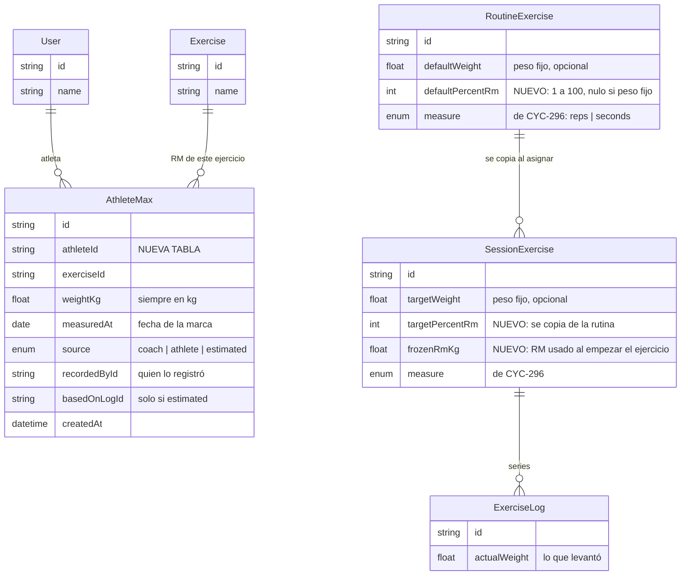
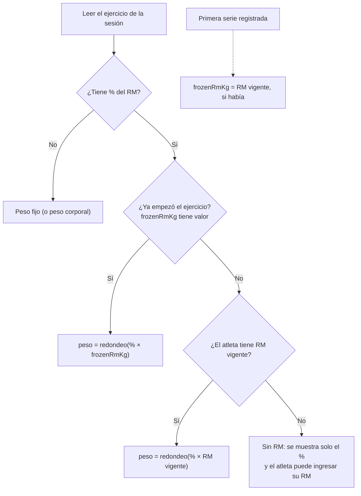

# RM del atleta por ejercicio y carga como % del RM (CYC-305)

> Contrastado con `origin/main` (2026-11-20). Estado: **propuesto, a la espera del «apruebo»**. Sin cambios de código. Maquetas en [`propuestas.html`](propuestas.html); capturas en `capturas/`. Origen: un coach nuevo del piloto, con un equipo de voleibol, pidió registrar el RM de cada atleta por ejercicio y planificar la carga como % del RM. Tarjeta hermana de API: CYC-306 (Desarrollo general).

## Qué hay hoy

- La carga es un peso fijo y opcional: `RoutineExercise.defaultWeight`, `SessionExercise.targetWeight`, `ExerciseLog.actualWeight` (siempre en kg; nulo = peso corporal). No existe RM ni carga relativa.
- Una rutina es del coach, no de un atleta. Al asignarla a una celda de un ciclo, sus filas se **copian** a `SessionExercise`, que sí pertenece al ciclo de un atleta ([`sessions.service.ts`](../../../apps/api/src/sessions/sessions.service.ts) línea 92).
- Hoy un ciclo de la Biblioteca se asigna **a un atleta a la vez** (selector de atleta y fecha). Este diseño no agrega asignación masiva: «varios atletas» significa el mismo ciclo asignado a cada uno, y cada uno recibe su propio peso.
- La fila del constructor tiene Ser., Reps, Carga, Desc. y RIR ([`ExerciseRowEditor.tsx`](../../../apps/web/src/components/builder/ExerciseRowEditor.tsx)). La app prellena el peso con `targetWeight` y muestra «4 × 6 · 60 kg» en Hoy.
- Los ejercicios de peso corporal (`isBodyweight`) no llevan carga.
- La propuesta de CYC-296 (ejercicios por tiempo, PR #257) sigue abierta: aquí se diseña para que ambas convivan.

## Decisiones propuestas

| # | Tema | Recomendación | Alternativa |
|---|---|---|---|
| 1 | Quién registra el RM | **Ambos.** El coach lo agrega y actualiza desde la ficha del atleta; el atleta, desde su sesión o desde Cuenta › Mis RM. Cada registro guarda fecha, origen (Coach / Atleta / Estimado) y quién lo puso. | Solo el coach (más simple, pero el atleta sin RM queda esperando). |
| 2 | Cómo se actualiza | Cada cambio es un **registro nuevo**; el vigente es el más reciente y el anterior queda en el historial. Igual que las series (`ExerciseLog`), nunca se pisa. | Un solo valor editable (se pierde el historial). |
| 3 | Constructor | **A.** La celda de Carga lleva el selector «kg ⌄ / % RM ⌄» (mismo patrón que «reps ⌄ / s ⌄» de CYC-296) y una **vista previa opcional** con el RM de un atleta, que agrega la columna «Peso de Valentina». | B: sin vista previa; el peso solo se ve al asignar. |
| 4 | Ejercicio por tiempo | La carga queda en **kg**; «% del RM» se apaga (el RM es de una repetición). | Permitir % en tiempo (no tiene sentido). |
| 5 | Atleta sin RM en un ejercicio | **Nunca bloquea.** En la sesión del atleta la fila dice «Sin RM» y el coach elige: ingresar el RM, usar peso fijo en esa sesión o dejarlo así (el atleta ve el % y puede ingresar su RM). Al asignar el ciclo se ofrece lo mismo, con «Asignar igual y pedirle su RM» como opción por defecto. | Bloquear la asignación hasta tener RM (frena al coach). |
| 6 | Si cambia el RM después de asignar | El peso es **vivo** mientras el ejercicio no se haya empezado: usa el RM vigente. Al registrar la primera serie del ejercicio, se **congela** el RM usado. Lo ya registrado no cambia. | Foto al asignar y botón «Recalcular» (más control, más trabajo para el coach). |
| 7 | Redondeo | Al **2,5 kg** más cercano (5 lb si el atleta usa libras): 80 % de 90 kg = 72 → 72,5 kg. | Sin redondeo (72 kg, no hay disco). |
| 8 | Rango del % | Entero de 1 a 100. | Hasta 120 (excéntricos). |
| 9 | RM estimado desde las series | Se diseña como **sugerencia** que el coach confirma («Usar 57 kg»); nunca reemplaza un RM solo. Recomiendo **dejarlo para una segunda entrega** y que el modelo ya lo admita (`source = estimated`). | Incluirlo en la primera entrega. |
| 10 | Avisos al atleta | Notificación breve cuando el coach registra o cambia su RM, y cuando el coach le pide ingresarlo. Sin datos de salud. | Sin avisos. |
| 11 | Ejercicios con RM | Solo los que se cargan: los de peso corporal no tienen RM. | Cualquiera. |

## Qué se ve en cada lugar

| Lugar | Con RM | Sin RM |
|---|---|---|
| Constructor de rutina (web) | `80 % RM ⌄` y, con vista previa, «72,5 kg» | Con vista previa: «Sin RM» |
| Sesión de un atleta (web) | `80 % RM` y «72,5 kg» | «Sin RM ⌄» con tres salidas |
| Hoy (app y web) | `4 × 6 · 72,5 kg` | `3 × 10 · 75 % de tu RM` |
| Registro de la serie | Meta «6 × 72,5 kg», chip «80 % de tu RM de 90 kg», peso prellenado | «Aún no tienes RM en Hip thrust» con «Ingresar mi RM» y «Registrar sin RM» |
| Serie guardada | `6 reps · 72,5 kg` | Lo que el atleta registró |
| Ficha del atleta (web) | Tabla «Con RM»: ejercicio, RM, fecha, origen | Tabla «Sin RM en su plan» primero |
| Ciclo en la Biblioteca (web) | Matriz atletas × ejercicios con %: «72,5 kg» | «Sin RM» |
| Cuenta › Mis RM (app) | Lista con origen y fecha | «Sin RM en mi plan» con «Agregar» |

Las pantallas nuevas cuidan la regla de no poner líneas grises bajo los títulos: el contexto va en columnas, etiquetas o el propio dato. No hay pantallas de Resumen.

## Cambio de modelo (diagrama)

Aditivo: una tabla nueva y columnas nulas. No toca datos existentes.

Reglas del modelo:

- **Peso fijo o %, no ambos.** Si `defaultPercentRm` / `targetPercentRm` tiene valor, el peso fijo va nulo (y al revés). No hace falta un enum.
- **El % solo con `measure = reps`.** Si CYC-296 aún no se mezcló al construir, la regla se agrega cuando existan ambos.
- **`AthleteMax` es solo-agregar.** El RM vigente de un atleta y un ejercicio es el de `measuredAt` más reciente (empate: el último creado). Un error se corrige con otro registro.
- **Índice** por `(athleteId, exerciseId, measuredAt)`. Lectura y escritura: control R5 coach–atleta; el atleta solo escribe los suyos.
- **El peso no se guarda: se calcula al leer.** La API lo devuelve en la estructura de la sesión.

Cómo se resuelve el peso que ve el atleta:

## Para Desarrollo general (CYC-306) y las tarjetas que salen de este diseño

| # | Trabajo | Dónde |
|---|---|---|
| 1 | Migración aditiva: tabla `AthleteMax`, columnas `defaultPercentRm`, `targetPercentRm`, `frozenRmKg` (respaldo antes; aprobación de la usuaria antes de migrar) | `apps/api/prisma` |
| 2 | Leer, agregar y actualizar el RM de un atleta (coach) y el propio (atleta); historial; lista «con RM / sin RM en su plan» por atleta | `apps/api` |
| 3 | `percentRm` en rutinas y en agregar o editar ejercicio de sesión; validación (1 a 100, solo con reps, no junto a peso fijo); copia al asignar | `apps/api/src/routines`, `sessions` |
| 4 | Peso calculado en la estructura de sesión (`resolvedWeight`, `rmKg`, `hasRm`); congelar al primer registro; redondeo a 2,5 kg | `apps/api/src/sessions`, `execution` |
| 5 | Cobertura de un ciclo: atletas asignados × ejercicios con %, con peso o «Sin RM» | `apps/api/src/cycles` |
| 6 | Constructor web: selector «kg / % RM» en la celda, vista previa con un atleta, «Sin RM» en la sesión | `apps/web` |
| 7 | Ficha del atleta: sección RM; aviso al asignar; pantalla de cobertura | `apps/web` |
| 8 | App del atleta: peso prellenado, «Ingresar mi RM», Cuenta › Mis RM | `apps/mobile` |
| 9 | Helper compartido para mostrar «72,5 kg» y «75 % de tu RM» | `packages/shared` |
| 10 | Dos fichas de novedad | ver abajo |
| 11 | Política de privacidad: confirmar que el RM entra en los datos de entrenamiento que ya ve el coach | PRD-PrivacidadYTerminos |

El RM es una marca de rendimiento del atleta, no un dato de salud (R7 no aplica), pero conviene dejarlo escrito en la política antes de salir.

## Fichas de novedad (popup)

Dos fichas: cada rol la ve en su plataforma. Textos de hasta 140 caracteres (miden 68, 65, 85, 87 y 66).

- `coach-rm-percent@1` (web, coach), 3 slides:
  1. «Carga como % del RM»: «Elige % del RM en cada fila y Cycles calcula el peso de cada atleta.» Demo `rm-percent-row`.
  2. «El RM de cada atleta»: «Regístralo en su ficha, con fecha. Verás en qué ejercicios falta.» Demo `rm-athlete-sheet`.
  3. «Revisa antes de asignar»: «Al asignar un ciclo, ves en qué ejercicios el atleta no tiene RM y decides qué hacer.» Demo `rm-assign-check`.
- `athlete-rm-percent@1` (app y web, atleta), 2 slides:
  1. «Tu peso, calculado»: «Tu coach puede indicar un % de tu RM. Verás el peso en kg ya calculado para cada serie.» Demo `athlete-rm-percent`.
  2. «Guarda tu RM»: «Si falta tu RM, ingrésalo desde la sesión o desde Cuenta › Mis RM.» Demo `athlete-rm-enter`.

No hace falta un tour nuevo.

## Accesibilidad

- «Sin RM» y los orígenes (Coach, Atleta, Estimado) van en texto, no solo en color. Verde y naranja acompañan a la palabra.
- Los campos de RM y de % aceptan teclado numérico; el selector «kg / % RM» se abre con el teclado y anuncia la opción elegida.
- En la app los pasos de peso y repeticiones miden 56 pt.
- «72,5 kg» usa coma decimal, como el resto de la app.

## Fuera de alcance

- Asignación masiva a varios atletas a la vez (hoy es de a uno).
- Estimación automática del RM (queda como sugerencia, segunda entrega).
- Ver o editar el RM desde la app del coach (CYC-294 es solo lectura por ahora).
- Gráficos de evolución del RM.

## Preguntas para la usuaria

1. ¿El RM lo registran el coach y el atleta, con fecha y origen? (Recomendado: ambos.)
2. Constructor: ¿A (selector en la celda con vista previa) o B (sin vista previa)?
3. ¿Sin RM nunca se bloquea, y el coach elige entre ingresar, peso fijo o dejarlo así? ¿Y «Asignar igual y pedirle su RM» como opción por defecto?
4. ¿El peso se actualiza solo con el RM nuevo hasta que el atleta empieza el ejercicio, y después se congela?
5. ¿Redondeo al 2,5 kg más cercano?
6. ¿% de 1 a 100?
7. ¿La estimación del RM desde las series va en una segunda entrega?
8. ¿Se avisa al atleta cuando el coach registra, cambia o le pide su RM?
9. ¿Solo los ejercicios que se cargan pueden tener RM (no los de peso corporal ni los por tiempo)?
