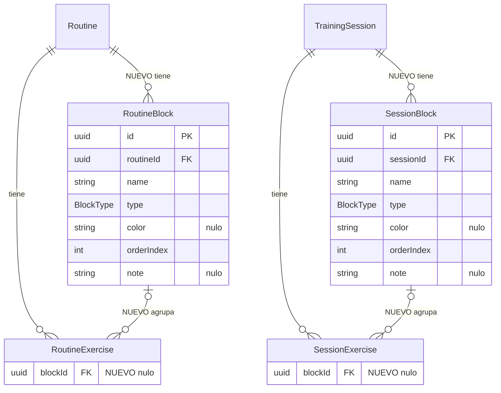

# Sesión por bloques (CYC-267)

> Contrastado con `origin/main` (9677590+). Estado: construido y en producción (CYC-271 y CYC-275, PRs #227 a #235); el constructor es una página propia, ya no un cajón. Maqueta en [`propuestas.html`](propuestas.html). La usuaria pidió agrupar los ejercicios de una rutina en bloques (calentamiento, pliometría, fuerza) y mandó la captura de la pantalla actual: `apps/web/src/pages/SessionDetailPage.tsx`, con ejercicios sueltos y «Quitar» y «Agregar nota» en cada fila.

## Color por tipo de bloque (2026-11-08)

La usuaria pidió variar el color: **cada tipo de bloque tiene el suyo, y ninguno es azul** (el azul es de la app). Calentamiento ámbar `#e8a317`, Pliometría rosa `#d9588f`, Fuerza verde `#2f9e5f`, Movilidad violeta `#8a63d2`, Vuelta a la calma verde azulado `#1fa39a`, Cardio naranja `#e0752b`, Superserie pizarra `#4a5568`. En el **bloque personalizado** el coach elige el nombre y el **color** entre 10 muestras (sin azules), con vista previa antes de crear. Cabecera y perla usan el color (cabecera a 11 % de opacidad); el tipo siempre se reconoce también por su ícono y su nombre.

## Qué cambia

La sesión pasa de **una lista plana** a **bloques**. Es la misma jerarquía en tres lugares: el detalle de la sesión (web del coach), el constructor de rutinas (página) y la app del atleta.

- **Bloques:** tarjeta plegable con perla de su color, nombre, resumen («2 ejercicios, 6 series») y menú ⋯. Tipos con ícono: **Calentamiento**, **Pliometría**, **Fuerza**, **Movilidad**, **Vuelta a la calma**, **Cardio**, **Superserie** (reservado: las reglas están en CYC-108) y **Personalizado** (el coach elige el nombre).
- **Ejercicio dentro del bloque:** nombre y nota del coach en una línea, y columnas **Series, Peso, RIR, Descanso**. «Quitar», «Editar» y «Mover a otro bloque» salen del menú ⋯; la nota se edita desde el lápiz. «Agregar ejercicio» vive al final de cada bloque.
- **Encabezado de la sesión:** título, estado (Pendiente, Hecha, Omitida), fecha y semana; resumen «3 bloques, 8 ejercicios, 22 series, descanso total estimado»; **Editar** y un menú ⋯ con «Mover a otro día» y «Borrar sesión» (con confirmación). El enlace de volver queda como «← Introducción» (con tilde).
- **Editar y reordenar:** con Editar aparecen asas de arrastre; se reordenan bloques y ejercicios, y un ejercicio se puede soltar en otro bloque (hueco punteado verde). «Agregar bloque» abre la lista de tipos. Quitar un ejercicio o bloque usa el aviso con **Deshacer** (patrón de la pizarra del ciclo).
- **Sesión hecha:** bloqueada como hoy («Ya se registró»); bajo cada ejercicio, **lo que registró el atleta** («Registró 3 × 8 a 62 kg») y en cada bloque «12 de 12».
- **Constructor de rutinas (página):** los mismos bloques con asas; al asignar una rutina a un día, los bloques y sus ejercicios se **copian** a la sesión y se editan sin tocar la plantilla.
- **App del atleta:** el bloque en curso se abre solo, los hechos se pliegan con «Hecho» y los pendientes quedan plegados; el botón principal dice el ejercicio que sigue («Continuar con Salto lateral»).
- **Rutinas y sesiones anteriores:** no cambian. Se ven como una sola lista, sin encabezado de bloque, con la acción **Agrupar en bloques**.

## Datos (para desarrollo)

Migración aditiva: tablas `RoutineBlock` y `SessionBlock` (id, rutina o sesión, nombre, tipo, **color** opcional para el personalizado, orden, nota opcional) y `blockId` nulo en `RoutineExercise` y `SessionExercise`. Tipos: calentamiento, pliometría, fuerza, movilidad, vuelta a la calma, cardio, personalizado y superserie (reservado). Al asignar, se copian los bloques y sus ejercicios. Las notas del coach (CYC-60 a 63) siguen por ejercicio. Sin datos de salud en avisos (R7).

### Diagrama del modelo (CYC-271, fase 1a)

Aditiva: no borra ni cambia datos. Al borrar un bloque sus ejercicios quedan sin bloque (`ON DELETE SET NULL`).

## Coherencia y reglas

- Azul solo de la app y botones; los tipos de bloque usan su propio color (sin azul). Radios y botones de la escala del coach (CYC-208). Texto en tuteo y con tildes.
- Responsive: en pantallas angostas las columnas pasan a dos líneas bajo el nombre; en la app la letra grande hace crecer los encabezados y apila las filas.
- Accesibilidad: cada bloque es una región plegable con nombre y estado; el arrastre tiene alternativa por menú («Mover a otro bloque»); estado nunca solo por color.

## Preguntas para la usuaria

1. ¿Los tipos de bloque propuestos son los que usas? ¿Falta alguno?
2. ¿El atleta ve los bloques plegados salvo el que sigue (propuesto) o todos abiertos?
3. ¿«Mover a otro día» sale de esta pantalla o solo de la pizarra del ciclo?
4. Superseries: se dejó el tipo reservado hasta cerrar CYC-108.
